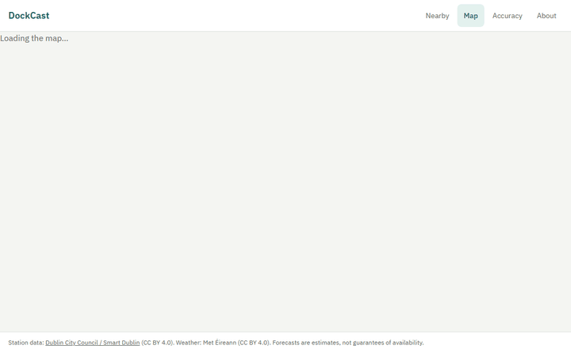

# DockCast

Station-level bike availability forecasting for Dublin Bikes: bikes at +30/+60/+120 min with a
P10-P90 range, and an honest account of where the model is wrong.

Status: **v3** (PRD 17, M0-M9 and M11-M19; M10 event classifiers wait for 12 weeks of collector
data). Live at https://dockcast.pages.dev, with the API at https://143-47-249-111.sslip.io.
A collector and a 15-min forecast job run in the cloud. Every number below is copied from a
generated report and carries its MLflow run ID; nothing is hand-typed.



Recorded from the live site with `make demo-gif`; the data shown is live, not a sample.

## Results (E1 backtest)

From `reports/experiments.md`, MLflow run `e4819616d7034b90abcb3adc882313da` (git `ed13e96`).
Rolling origin over 8 test weeks (2026-05-05 to 2026-06-30 UTC), 115 stations, about 600 k common
test rows per horizon, 120-min gap between training end and test start. **No weather features.**
MAE in bikes, mean over folds.

| horizon | LightGBM quantile | persistence | ridge | MASE (LightGBM) | P10-P90 coverage |
|---:|---:|---:|---:|---:|---:|
| +30 | 0.995 | 1.066 | 1.179 | 0.933 | 0.825 |
| +60 | 1.461 | 1.721 | 1.869 | 0.849 | 0.814 |
| +120 | 2.047 | 2.768 | 2.874 | 0.740 | 0.797 |

- LightGBM is the champion at every horizon (lowest MAE with coverage in range, PRD 12.5).
- Success criterion S1 (+60 MAE <= 0.85 x persistence = 1.463) is **met by 0.002 bikes**
  (1.461; fold std 0.061). Treat it as borderline.
- Ridge is worse than persistence at every horizon.
- This run reproduces the original E1 run `fb0d738826974ae9982cc4e96b96e5ba` exactly: every value
  in the E1 table and in `reports/error_analysis.md` is identical.

Where it is wrong (`reports/error_analysis.md`, same run): the largest +60 errors are at busy
40-dock stations (Charlemont Place 2.939, Grand Canal Dock 2.923); rush hour MAE at +60 is 2.235
against 1.203 off-peak; rebalancing-flagged rows have +60 MAE 11.307.

Production model: bundle `lgbm-q-2026-06-30-3c421b6`, MLflow run
`5c34442ebc3a4b46aca09893377ab030`, trained on all Format B history to 2026-06-30.

## v2 experiments

Same folds and test weeks as E1. Full tables are in `reports/experiments.md` and
`reports/error_analysis.md`; the MAE values below are in bikes.

- **E3 station groups**, run `9f7a9d468a8a422b82b98fb0d2a64ffa`: k-means with k = 4 on weekday
  and weekend occupancy profiles. The groups are stable across folds (adjusted Rand index 0.992)
  but only partly match between the 2021-24 and 2024-26 data (0.530).
- **E4 spatial features**, run `a972985884564e83aa5b120428bd5c74`: neighbours within 600 m
  improve MAE slightly. At +60 it is 1.456 vs 1.461, better in 7/8 folds.
- **E2 global vs per-station vs per-cluster**, run `470f72791f044cd39a6a9afd2a061cfd`:
  - one model per cluster: 0.987 / 1.445 / 2.028 at +30 / +60 / +120, vs global 0.995 / 1.461 /
    2.047, but with lower coverage;
  - one model per station is worse than global everywhere;
  - Prophet (5.44) is worse than persistence.
- **E2b low-data stations**, run `01131c8fc80b40b0abad2742db60f700`: with only 28 days of
  history, the global model still reaches 1.476 at +60. Per-station falls to 2.108.
- **E6 interval quality**, run `9f9688d815da4c4298891cfdd044219f`:
  - P10-P90 coverage is 0.825 / 0.814 / 0.797 and every station is within 0.70-0.90;
  - the range is too narrow around 05-09 local and too wide at night.
- **E7 ablation at +60**, run `abd37ee684b04b2ab419e4775f4ec512`:
  - removing lags costs +0.109 and calendar +0.065;
  - spatial and seasonal add +0.007 each;
  - **oracle** weather adds +0.000. This is observed weather at the target time, so it is an
    upper bound: even perfect weather does not help at +60 in these May-June weeks.
  - Dropping rolling or station_static slightly improves MAE.
- **Champion**: the PRD 12.5 rule picks per-cluster at +60, with a 1.1 % gain. The owner kept
  `lgbm_global` at every horizon (PRD 23) because of lower coverage and the extra serving
  pipeline it would need.

## Drift and retraining (E8)

From `reports/experiments.md`, MLflow run `021e26cd001d459497c1b09834284d81`. +60 only, 52
gap-free test weeks from 2025-05-09 to 2026-06-30, Format B data, **no weather**, every model
scored on the same 3,939,778 rows. MAE in bikes, mean over weeks.

| scheme | MAE | MASE | P10-P90 coverage |
|---|---:|---:|---:|
| persistence | 1.692 | 1.000 | - |
| trained once before week 1 (`lgbm_fixed`) | 1.457 | 0.866 | 0.794 |
| retrained weekly on all history (`lgbm_weekly`) | 1.444 | 0.859 | 0.807 |
| retrained weekly on the last 12 weeks (`lgbm_rolling12`) | 1.469 | 0.875 | 0.768 |

- A model trained once and never updated is only 0.013 bikes behind weekly retraining over a
  year. Weekly is better in 49 of 52 weeks, but the gap barely grows: +0.0012 bikes per 4
  weeks. Over this year the drift is small.
- A 12-week window is worse than using all history (+0.025) and its interval is too narrow
  (coverage 0.768).
- Seasonality moves the error more than model age does: weekly MAE by quarter runs from 1.352
  (2026Q1) to 1.531 (2025Q2).

## Rebalancing simulation (E9) — simulation, not a measurement

From `reports/experiments.md`, MLflow run `1716b5e76b114ef99816baaadb3a2938`, on E1's 8 test weeks at +60 using E1's
forecasts. Demand is a replay of each station's observed net change, with the real operator's van moves
removed. There are 2 vans of 20 bikes, each making one move per hour from 06:00 to 22:00. Riders
are assumed not to react, and travel time is ignored. Figures are stockout-minutes per week, over
all 115 stations.

| policy | stockout min | moves |
|---|---:|---:|
| no action | 204581 | 0 |
| greedy on persistence (current state) | 65711 | 211 |
| greedy on LightGBM P50 | 54643 | 210 |

- With the same vans, planning on the LightGBM forecast beat planning on the current state in
  8 of 8 weeks: 11,068 fewer stockout-minutes per week. With 1 van the gain is 20,781 and with 4
  vans it is 6,684.
- The absolute values are an upper bound. In a replay a delivered bike stays until the observed
  net change drains it, so 502 to 940 minutes are avoided per move, and λ up to 20 minutes per
  move does not change the ranking.

## Site performance

`reports/lighthouse.md`: accessibility 100 on every page, mobile and desktop. Performance is
at least 90 on 6 of 10 page and form pairs. Map mobile is 92 (33 before M18). The misses are
map desktop (88) and, on mobile, Accuracy (84), Station (83) and About (89). On those mobile
pages, the time to run the app's JavaScript on a throttled phone sets the score.

## Limitations

- **No weather in the served model.** Weather is collected but is not a model feature. E7 found
  that even oracle weather adds nothing measurable at +60; forecast weather has not been tested.
- **No event classifiers yet** (E5, M10). These need 12 weeks of collector data.
- **S1 is borderline** (0.002 bikes margin, well inside one fold std).
- **Untuned.** 51 of 72 LightGBM boosters used all 2000 rounds without early stopping
  (PRD 12.3 defaults); v2 did not tune either.
- **Weekend +30:** LightGBM MAE 0.750 vs persistence 0.732 — slightly worse than "no change".
- **Rebalancing** is not observed directly; van moves show up as large errors (flagged rows).
- **Training/live gap.** Training data ends 2026-06-30; the live collector started 2026-10-22, so
  live forecasts run on a model that has not seen recent months. E8 suggests this costs little
  at +60 (0.013 bikes over a year), but it was measured on the historical feed, not the live one.
- **New stations.** Station 118 is not in the training set and has no forecast until a retrain.
- **No trip data.** There are no origin-destination flows; only dock counts are modelled.
- Forecasts are estimates, not guarantees of availability.

## Architecture

```
GBFS feed (60 s) ─► collector ─► Postgres (raw status) ─► resample 15 min ─► features (cutoff-safe)
Historical CSVs ──► backfill ──┘                                               │
                                                     LightGBM P10/P50/P90 per horizon ◄─┘
                                                                │
                                   forecast job (every 15 min) ─► forecasts table ─► FastAPI
```

- `dockcast/ingest` — live GBFS collector, historical CSV loaders, calendar, weather.
- `dockcast/transform`, `dockcast/quality` — 15-min resample, gap and data-quality reports.
- `dockcast/features` — lags, rolling, seasonal, calendar, static; every feature takes a `cutoff`
  and has a leakage test in `tests/leakage/`.
- `dockcast/models`, `dockcast/evaluation` — baselines, ridge, LightGBM quantiles, rolling-origin
  backtest, champion selection, error analysis. Tracked in MLflow.
- `dockcast/serving`, `dockcast/api` — production training, forecast job, FastAPI.
- Stack: Python 3.12, uv, PostgreSQL (Supabase in the cloud), Alembic, LightGBM, scikit-learn,
  MLflow, FastAPI, Docker (Oracle Cloud VM). `deploy/oracle/README.md` has the cloud setup.

## Reproduce

Requires `uv`, Docker and GNU Make.

```bash
cp .env.example .env   # set POSTGRES_PORT / DATABASE_URL if 5432 is taken
make all               # setup, db-up, backfill, gaps, capacity, calendar, weather, resample,
                       # eda, backtest E=E1, error-analysis, results
make test              # ruff, mypy --strict, pytest (unit, leakage, integration, api)
```

`make all` downloads about 2.4 GB of historical CSVs and the E1 backtest takes about 3.5 hours on
a laptop. Outputs: `reports/experiments.md`, `reports/error_analysis.md`, `reports/site/index.html`.

**How v1 was checked:** the E1 table above was reproduced with `make backtest E=E1` and
`make error-analysis` on the existing local database. The download and load steps of `make all`
(`backfill` through `eda`) were **not** rerun from a fresh clone for this release.

Live pieces: `make collect` (poll the feed every 60 s), `make train`, `make forecast`,
`make serve` (API on localhost), `make health` (collector uptime), `make web` (web app on
http://localhost:5173 against the local API; `make web-api` regenerates its typed client).

## Data

Dublin Bikes data © Dublin City Council / Smart Dublin, CC BY 4.0. Weather data © Met Éireann.

## Licence

Code: MIT (see `LICENSE`).
