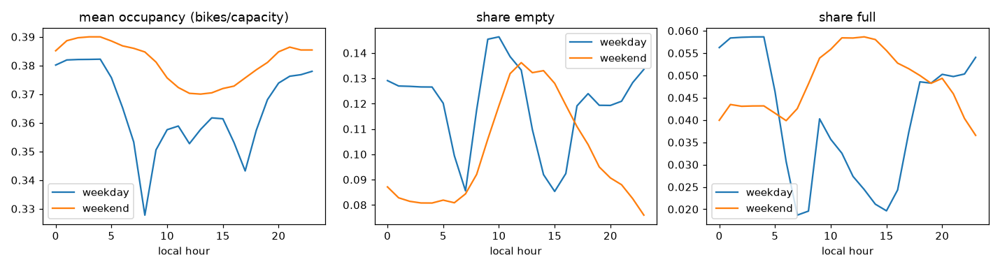
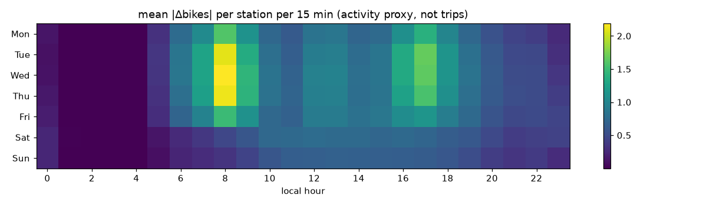
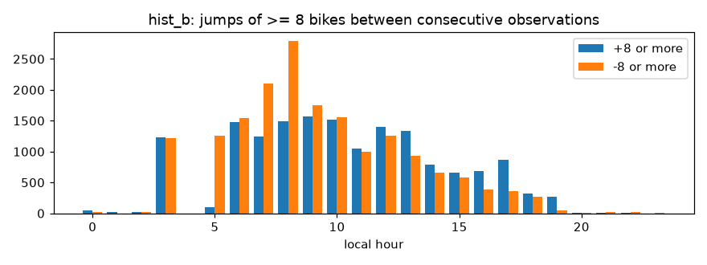
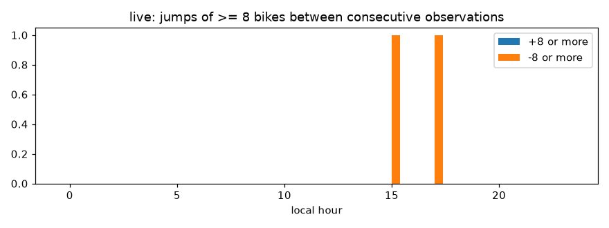

# Exploratory data analysis

Generated by `dockcast.quality.eda` at 2026-10-25 21:20 UTC, git `4ccdc8a`. Main window: **Format B** 2024-05-02T19:00 → 2026-06-30T23:55 UTC (training scope, PRD 9.1a). Descriptive statistics only; no model metrics, so no MLflow run (MLflow starts in M3).
Data © Dublin City Council / Smart Dublin (CC BY 4.0); weather © Met Éireann (CC BY 4.0).

## 1. Coverage

| source | rows | stations | first | last |
|---|---|---|---|---|
| hist_a | 4759858 | 115 | 2021-09-30 23:00:03+00:00 | 2024-02-29 23:30:03+00:00 |
| hist_b | 15149940 | 115 | 2024-05-02 19:00:00+00:00 | 2026-06-30 23:55:00+00:00 |
| live | 125350 | 115 | 2026-10-15 15:08:05+00:00 | 2026-10-22 22:27:59+00:00 |

Data gaps (`reports/data_gaps.md`): 38 gaps, 216.4 days in total.

## 2. Occupancy, empty and full by hour

Highest empty share 0.146 at 10:00 (weekday); highest full share 0.059 at 13:00 (weekend).

## 3. Activity by hour and weekday

## 4. Activity vs weather (weekdays 07-20 local, Dublin Airport hourly observations)

Hourly network-mean |Δbikes| joined to the observation for that hour (rain = mm in the hour ending at the observation). Not controlled for season or hour.

| rain_mm | mean_turnover | hours |
|---|---|---|
| 0 | 1.048 | 6484 |
| 0-0.5 | 0.932 | 610 |
| 0.5-2 | 0.799 | 275 |
| >2 | 0.762 | 77 |

| temp_c_bin | mean_turnover | hours |
|---|---|---|
| <5 | 0.974 | 740 |
| 5-10 | 0.959 | 1712 |
| 10-15 | 1.057 | 2803 |
| 15-20 | 1.053 | 1830 |
| >20 | 1.071 | 361 |

Weather QC: 18143 of 21169 hours since 2024-05-02 (85.7%) carry indicator 111 ("investigation required": not yet quality-controlled by Met Éireann).

## 5. Closures (`is_renting = false`)

| source | not_renting | rows |
|---|---|---|
| hist_a | 2261 | 4759858 |
| hist_b | 17100 | 15149940 |
| live | 2185 | 125350 |

## 6. Large count jumps (rebalancing candidates, PRD 9.3)

**hist_b**, consecutive observations ≤ 10 min apart (15007266 pairs): |Δ| ≥ 4: 141439 (0.942%), |Δ| ≥ 6: 60939 (0.406%), |Δ| ≥ 8: 33961 (0.226%), |Δ| ≥ 10: 17922 (0.119%), |Δ| ≥ 12: 9710 (0.065%)

**live**, consecutive observations ≤ 5 min apart (124775 pairs): |Δ| ≥ 4: 39 (0.031%), |Δ| ≥ 6: 12 (0.010%), |Δ| ≥ 8: 2 (0.002%), |Δ| ≥ 10: 1 (0.001%), |Δ| ≥ 12: 0 (0.000%)

## 7. Flat-lined counts (owner decision 2026-10-15: flag stations unchanged > N h)

Format B: 4736440 runs of identical bike counts while renting; run length (h) p50 = 0.08, p90 = 0.58, p99 = 6.17, p99.9 = 11.75. Runs > 6 h: 49414, > 12 h: 4218, > 24 h: 380, > 48 h: 105.

| station_key | run_start | hours |
|---|---|---|
| 50 | 2024-11-04 09:50:00+00:00 | 9099.6 |
| 69 | 2024-12-10 17:05:00+00:00 | 3548.8 |
| 50 | 2024-06-21 11:20:00+00:00 | 1781.0 |
| 34 | 2026-01-13 10:05:00+00:00 | 724.0 |
| 78 | 2024-09-03 14:00:00+00:00 | 664.8 |
| 100 | 2024-09-03 16:15:00+00:00 | 662.6 |
| 75 | 2024-09-03 14:35:00+00:00 | 662.2 |
| 60 | 2024-09-03 15:45:00+00:00 | 661.2 |
| 56 | 2024-09-03 16:25:00+00:00 | 661.1 |
| 20 | 2024-09-03 16:30:00+00:00 | 660.2 |

## 8. bikes + docks vs current capacity

**hist_b**

| relation | n |
|---|---|
| equal | 14162773 |
| below (disabled docks?) | 872575 |
| over capacity+2 | 114354 |
| over by 1-2 | 238 |

**live**

| relation | n |
|---|---|
| equal | 117647 |
| below (disabled docks?) | 7698 |
| over by 1-2 | 5 |
