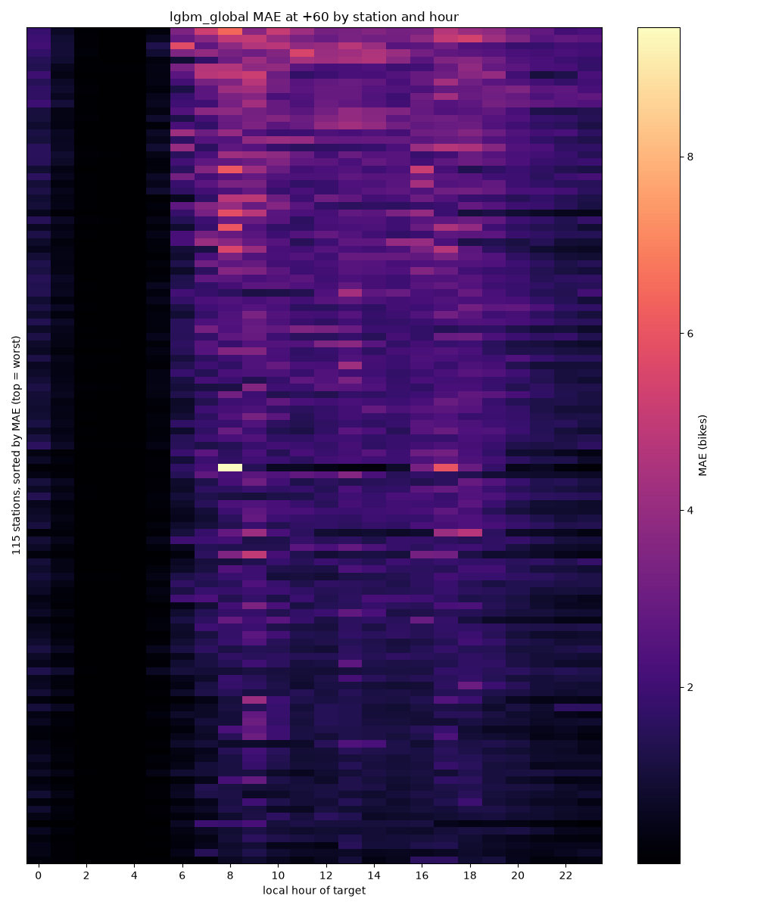

# Error analysis (v1)

MLflow run `fb0d738826974ae9982cc4e96b96e5ba` (E1) · git `67fa753` · 1805629 scored test rows, folds 1-8, horizons +30, +60, +120 · target 2026-05-06 → 2026-06-30 UTC. Main model `lgbm_global`; errors are prediction - actual (bikes). No weather features.

## 1. Top 10 stations by MAE (+60)

| station_key | name | mae | mae_persistence | capacity | mean_bikes | share_empty | share_rebalance | abs_change_4 |
|---|---|---|---|---|---|---|---|---|
| 5 | CHARLEMONT PLACE | 2.939 | 3.703 | 40.000 | 19.957 | 0.028 | 0.058 | 3.711 |
| 68 | GRAND CANAL DOCK | 2.923 | 3.382 | 40.000 | 16.899 | 0.058 | 0.026 | 3.388 |
| 14 | FOWNES STREET UPPER | 2.654 | 3.089 | 30.000 | 20.564 | 0.016 | 0.022 | 3.076 |
| 33 | PRINCES STREET / O'CONNELL STREET | 2.636 | 3.051 | 23.000 | 15.363 | 0.004 | 0.022 | 3.049 |
| 9 | EXCHEQUER STREET | 2.446 | 2.932 | 24.000 | 12.292 | 0.072 | 0.019 | 2.934 |
| 34 | LENNOX STREET | 2.272 | 2.820 | 40.000 | 14.366 | 0.037 | 0.016 | 2.829 |
| 57 | SIR PATRICK DUN'S | 2.254 | 2.591 | 40.000 | 16.329 | 0.053 | 0.014 | 2.586 |
| 67 | HANOVER QUAY | 2.246 | 2.920 | 40.000 | 14.291 | 0.061 | 0.016 | 2.919 |
| 69 | BARROW STREET | 2.242 | 2.357 | 21.000 | 13.003 | 0.024 | 0.006 | 2.358 |
| 66 | THE POINT | 2.219 | 2.392 | 40.000 | 16.575 | 0.027 | 0.004 | 2.392 |

## 2. Error by station and hour (+60)

## 3. Do we under-predict sharp changes? Error vs change over the last hour (+60)

Recent change = bikes(t) - bikes(t - 60 min). Negative bias = under-prediction.

| recent_change | rows | bias_lgbm_global | mae_lgbm_global | bias_persistence | mae_persistence |
|---|---|---|---|---|---|
| <= -6 | 21301 | -0.380 | 2.597 | 1.434 | 4.046 |
| -5..-2 | 82788 | -0.079 | 1.999 | 0.544 | 2.442 |
| -1..+1 | 395880 | -0.059 | 1.064 | -0.030 | 1.155 |
| +2..+5 | 79894 | 0.040 | 2.139 | -0.470 | 2.502 |
| >= +6 | 22228 | 0.407 | 2.982 | -1.163 | 4.103 |

## 4. Error growth with horizon (MAE, bikes)

| horizon_min | lgbm_global | persistence | ridge |
|---|---|---|---|
| 30 | 0.995 | 1.067 | 1.180 |
| 60 | 1.461 | 1.722 | 1.869 |
| 120 | 2.047 | 2.770 | 2.874 |

## 5. Large errors (|error| > 5 bikes) and rebalancing

| model | large_errors | share_of_rows | share_rebalance_flagged | flagged_share_all_rows |
|---|---|---|---|---|
| lgbm_global | 112655 | 0.062 | 0.095 | 0.007 |
| persistence | 151880 | 0.084 | 0.072 | 0.007 |
| ridge | 159304 | 0.088 | 0.069 | 0.007 |

## 6. Weekday vs weekend (MAE, bikes)

| horizon_min | weekend | lgbm_global | persistence | ridge |
|---|---|---|---|---|
| 30 | weekday | 1.095 | 1.202 | 1.287 |
| 30 | weekend | 0.750 | 0.732 | 0.915 |
| 60 | weekday | 1.597 | 1.957 | 2.030 |
| 60 | weekend | 1.127 | 1.145 | 1.473 |
| 120 | weekday | 2.229 | 3.190 | 3.101 |
| 120 | weekend | 1.604 | 1.745 | 2.321 |
