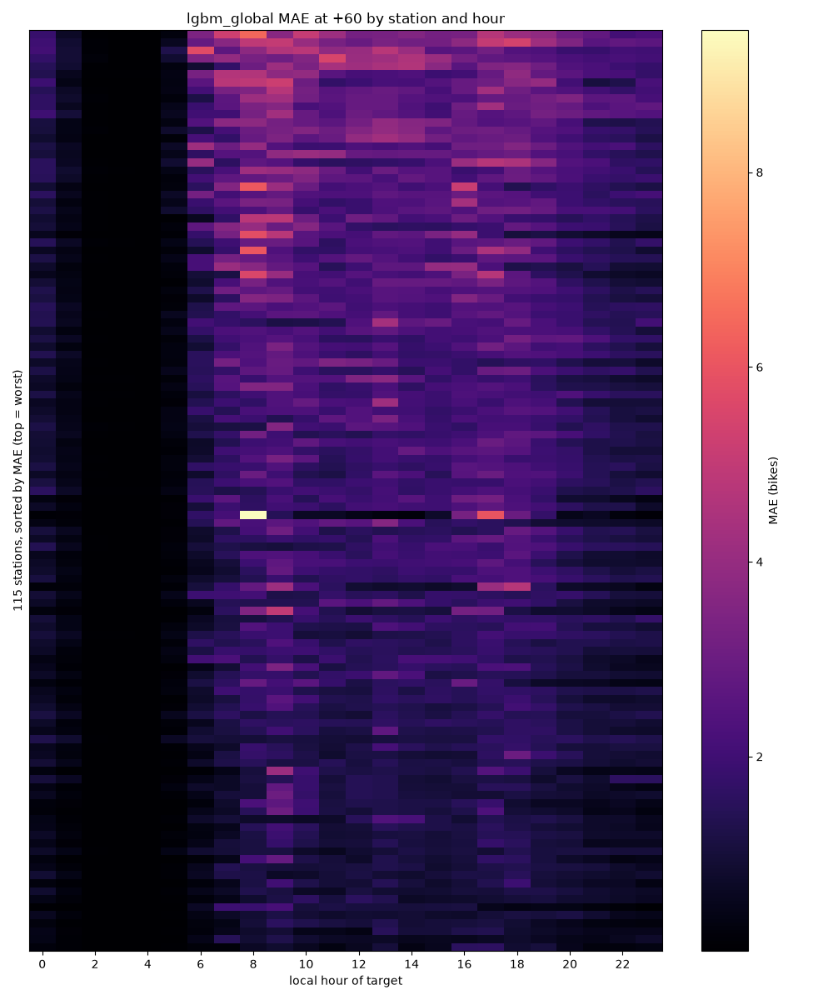

# Error analysis (v2)

MLflow run `e4819616d7034b90abcb3adc882313da` (E1) and `470f72791f044cd39a6a9afd2a061cfd` (E2: `lgbm_per_cluster` and the in-fold E3 cluster on the same rows) · git `baa7da7` · 1805629 scored test rows, folds 1-8, horizons +30, +60, +120 · target 2026-05-06 → 2026-06-30 UTC. Main model `lgbm_global`; errors are prediction - actual (bikes). No weather features.

## 1. Top 10 stations by MAE (+60)

| station_key | name | mae | mae_persistence | capacity | mean_bikes | share_empty | share_rebalance | abs_change_4 |
|---|---|---|---|---|---|---|---|---|
| 5 | CHARLEMONT PLACE | 2.939 | 3.703 | 40.000 | 19.957 | 0.028 | 0.058 | 3.711 |
| 68 | GRAND CANAL DOCK | 2.923 | 3.382 | 40.000 | 16.899 | 0.058 | 0.026 | 3.388 |
| 14 | FOWNES STREET UPPER | 2.654 | 3.089 | 30.000 | 20.564 | 0.016 | 0.022 | 3.076 |
| 33 | PRINCES STREET / O'CONNELL STREET | 2.636 | 3.051 | 23.000 | 15.363 | 0.004 | 0.022 | 3.049 |
| 9 | EXCHEQUER STREET | 2.446 | 2.932 | 24.000 | 12.292 | 0.072 | 0.019 | 2.934 |
| 34 | LENNOX STREET | 2.272 | 2.820 | 40.000 | 14.366 | 0.037 | 0.016 | 2.829 |
| 57 | SIR PATRICK DUN'S | 2.254 | 2.591 | 40.000 | 16.329 | 0.053 | 0.014 | 2.586 |
| 67 | HANOVER QUAY | 2.246 | 2.920 | 40.000 | 14.291 | 0.061 | 0.016 | 2.919 |
| 69 | BARROW STREET | 2.242 | 2.357 | 21.000 | 13.003 | 0.024 | 0.006 | 2.358 |
| 66 | THE POINT | 2.219 | 2.392 | 40.000 | 16.575 | 0.027 | 0.004 | 2.392 |

## 2. Error by station and hour (+60)

## 3. Do we under-predict sharp changes? Error vs change over the last hour (+60)

Recent change = bikes(t) - bikes(t - 60 min). Negative bias = under-prediction.

| recent_change | rows | bias_lgbm_global | mae_lgbm_global | bias_persistence | mae_persistence |
|---|---|---|---|---|---|
| <= -6 | 21301 | -0.380 | 2.597 | 1.434 | 4.046 |
| -5..-2 | 82788 | -0.079 | 1.999 | 0.544 | 2.442 |
| -1..+1 | 395880 | -0.059 | 1.064 | -0.030 | 1.155 |
| +2..+5 | 79894 | 0.040 | 2.139 | -0.470 | 2.502 |
| >= +6 | 22228 | 0.407 | 2.982 | -1.163 | 4.103 |

## 4. Error growth with horizon (MAE, bikes)

| horizon_min | lgbm_global | lgbm_per_cluster | persistence | ridge |
|---|---|---|---|---|
| 30 | 0.995 | 0.987 | 1.067 | 1.180 |
| 60 | 1.461 | 1.446 | 1.722 | 1.869 |
| 120 | 2.047 | 2.029 | 2.770 | 2.874 |

## 5. Large errors (|error| > 5 bikes) and rebalancing

| model | large_errors | share_of_rows | share_rebalance_flagged | flagged_share_all_rows |
|---|---|---|---|---|
| lgbm_global | 112655 | 0.062 | 0.095 | 0.007 |
| lgbm_per_cluster | 110593 | 0.061 | 0.096 | 0.007 |
| persistence | 151880 | 0.084 | 0.072 | 0.007 |
| ridge | 159304 | 0.088 | 0.069 | 0.007 |

## 6. Weekday vs weekend (MAE, bikes)

| horizon_min | weekend | lgbm_global | lgbm_per_cluster | persistence | ridge |
|---|---|---|---|---|---|
| 30 | weekday | 1.095 | 1.084 | 1.202 | 1.287 |
| 30 | weekend | 0.750 | 0.747 | 0.732 | 0.915 |
| 60 | weekday | 1.597 | 1.579 | 1.957 | 2.030 |
| 60 | weekend | 1.127 | 1.118 | 1.145 | 1.473 |
| 120 | weekday | 2.229 | 2.207 | 3.190 | 3.101 |
| 120 | weekend | 1.604 | 1.596 | 1.745 | 2.321 |

## 7. Metrics by slice (PRD 13.3)

Horizon rows use every test row; the other slices are at +60. MASE is against persistence on the same rows; `cov` is P10-P90 coverage (target 0.80). Hours are local; rush hour is 07-10 and 16-19 local; `rebalance` is whether the target bucket is rebalance-flagged. Per-station errors are in sections 1-2.

| slice | value | rows | mae_global | rmse_global | mase_global | bias_global | cov_global | mae_per_cluster | rmse_per_cluster | mase_per_cluster | bias_per_cluster | cov_per_cluster |
|---|---|---|---|---|---|---|---|---|---|---|---|---|
| horizon | +30 | 604621 | 0.995 | 1.990 | 0.933 | -0.002 | 0.825 | 0.987 | 1.967 | 0.926 | 0.001 | 0.807 |
| horizon | +60 | 602561 | 1.461 | 2.689 | 0.848 | -0.042 | 0.814 | 1.446 | 2.654 | 0.839 | -0.043 | 0.798 |
| horizon | +120 | 598447 | 2.047 | 3.448 | 0.739 | -0.099 | 0.797 | 2.029 | 3.417 | 0.733 | -0.097 | 0.785 |
| hour | 0 | 25513 | 0.892 | 1.427 | 0.966 | -0.042 | 0.788 | 0.880 | 1.407 | 0.953 | -0.047 | 0.784 |
| hour | 1 | 22781 | 0.382 | 0.726 | 1.359 | -0.048 | 0.860 | 0.381 | 0.723 | 1.355 | -0.042 | 0.848 |
| hour | 2 | 25519 | 0.032 | 0.129 | 3.846 | -0.008 | 0.910 | 0.031 | 0.127 | 3.709 | -0.008 | 0.875 |
| hour | 3 | 25081 | 0.013 | 0.087 | 3.455 | -0.004 | 0.899 | 0.014 | 0.087 | 3.611 | -0.003 | 0.862 |
| hour | 4 | 24622 | 0.008 | 0.052 | 6.371 | -0.002 | 0.893 | 0.009 | 0.053 | 7.181 | -0.001 | 0.853 |
| hour | 5 | 24624 | 0.247 | 0.827 | 1.141 | 0.034 | 0.761 | 0.241 | 0.823 | 1.109 | 0.046 | 0.716 |
| hour | 6 | 24622 | 1.278 | 2.854 | 0.940 | 0.041 | 0.785 | 1.246 | 2.858 | 0.917 | 0.167 | 0.760 |
| hour | 7 | 24633 | 1.834 | 3.365 | 0.823 | -0.052 | 0.785 | 1.819 | 3.319 | 0.816 | -0.031 | 0.762 |
| hour | 8 | 24635 | 2.448 | 4.154 | 0.721 | 0.292 | 0.756 | 2.390 | 3.993 | 0.704 | 0.274 | 0.742 |
| hour | 9 | 24644 | 2.561 | 3.996 | 0.613 | -0.394 | 0.791 | 2.499 | 3.900 | 0.599 | -0.369 | 0.772 |
| hour | 10 | 24692 | 2.057 | 3.374 | 0.851 | 0.060 | 0.820 | 2.058 | 3.350 | 0.852 | 0.062 | 0.801 |
| hour | 11 | 25031 | 1.809 | 3.159 | 0.932 | -0.056 | 0.814 | 1.796 | 3.123 | 0.925 | -0.068 | 0.800 |
| hour | 12 | 25416 | 1.859 | 3.115 | 0.940 | 0.006 | 0.812 | 1.844 | 3.091 | 0.933 | -0.016 | 0.803 |
| hour | 13 | 25505 | 2.150 | 3.528 | 0.955 | -0.225 | 0.793 | 2.135 | 3.507 | 0.948 | -0.240 | 0.786 |
| hour | 14 | 25511 | 1.922 | 3.089 | 0.978 | -0.138 | 0.817 | 1.907 | 3.062 | 0.970 | -0.141 | 0.808 |
| hour | 15 | 25512 | 1.825 | 2.853 | 0.959 | -0.047 | 0.818 | 1.811 | 2.831 | 0.952 | -0.067 | 0.805 |
| hour | 16 | 25524 | 2.082 | 3.197 | 0.850 | -0.031 | 0.793 | 2.037 | 3.103 | 0.831 | -0.126 | 0.789 |
| hour | 17 | 25531 | 2.295 | 3.478 | 0.693 | -0.040 | 0.794 | 2.286 | 3.485 | 0.690 | -0.065 | 0.783 |
| hour | 18 | 25533 | 2.198 | 3.280 | 0.753 | -0.147 | 0.777 | 2.172 | 3.225 | 0.744 | -0.195 | 0.770 |
| hour | 19 | 25532 | 1.879 | 2.813 | 0.908 | -0.095 | 0.802 | 1.871 | 2.797 | 0.904 | -0.078 | 0.795 |
| hour | 20 | 25531 | 1.563 | 2.311 | 0.955 | -0.051 | 0.806 | 1.558 | 2.299 | 0.952 | -0.029 | 0.801 |
| hour | 21 | 25531 | 1.303 | 1.903 | 0.962 | -0.038 | 0.819 | 1.294 | 1.894 | 0.955 | -0.018 | 0.809 |
| hour | 22 | 25522 | 1.186 | 1.775 | 0.951 | -0.008 | 0.810 | 1.175 | 1.759 | 0.943 | -0.010 | 0.798 |
| hour | 23 | 25516 | 1.122 | 1.736 | 0.954 | -0.012 | 0.831 | 1.117 | 1.732 | 0.949 | -0.008 | 0.820 |
| weekend | weekday | 428702 | 1.597 | 2.912 | 0.816 | -0.048 | 0.814 | 1.579 | 2.869 | 0.807 | -0.050 | 0.796 |
| weekend | weekend | 173859 | 1.127 | 2.038 | 0.985 | -0.029 | 0.813 | 1.118 | 2.029 | 0.977 | -0.025 | 0.801 |
| rush_hour | other | 452061 | 1.204 | 2.312 | 0.947 | -0.036 | 0.824 | 1.195 | 2.296 | 0.940 | -0.029 | 0.807 |
| rush_hour | rush | 150500 | 2.236 | 3.592 | 0.727 | -0.062 | 0.783 | 2.200 | 3.516 | 0.715 | -0.086 | 0.770 |
| capacity_band | <20 | 10574 | 1.126 | 1.903 | 0.919 | 0.033 | 0.815 | 1.114 | 1.889 | 0.909 | 0.037 | 0.796 |
| capacity_band | 20-29 | 151551 | 1.382 | 2.453 | 0.912 | 0.029 | 0.815 | 1.370 | 2.427 | 0.904 | 0.030 | 0.797 |
| capacity_band | 30-39 | 221809 | 1.455 | 2.660 | 0.838 | -0.034 | 0.813 | 1.443 | 2.636 | 0.831 | -0.041 | 0.799 |
| capacity_band | 40+ | 218627 | 1.539 | 2.900 | 0.821 | -0.104 | 0.813 | 1.517 | 2.848 | 0.809 | -0.100 | 0.797 |
| cluster | 0 | 249716 | 1.188 | 2.333 | 0.821 | -0.149 | 0.816 | 1.176 | 2.312 | 0.812 | -0.144 | 0.808 |
| cluster | 1 | 145197 | 1.568 | 2.799 | 0.864 | -0.164 | 0.816 | 1.551 | 2.762 | 0.854 | -0.160 | 0.799 |
| cluster | 2 | 86335 | 1.662 | 2.910 | 0.866 | 0.143 | 0.816 | 1.642 | 2.870 | 0.856 | 0.130 | 0.780 |
| cluster | 3 | 121313 | 1.754 | 3.052 | 0.861 | 0.192 | 0.805 | 1.737 | 2.998 | 0.853 | 0.183 | 0.788 |
| rebalance | flagged | 4092 | 11.291 | 12.486 | 0.859 | -0.393 | 0.291 | 11.099 | 12.264 | 0.845 | -0.418 | 0.302 |
| rebalance | normal | 598469 | 1.394 | 2.493 | 0.848 | -0.040 | 0.817 | 1.380 | 2.462 | 0.839 | -0.040 | 0.801 |

## 8. Champion per horizon (PRD 12.5)

Lowest fold-mean MAE among models with fold-mean coverage in [0.70, 0.90]; a simpler model within 1 % wins the tie (`lgbm_per_cluster` counts as less simple than `lgbm_global`). The API keeps serving `lgbm_global` until the owner decides to switch.

| horizon_min | champion | mae | coverage_80 | reason |
|---|---|---|---|---|
| 30 | lgbm_global | 0.995 | 0.825 | lowest MAE with coverage in range (simpler model within 1 %) |
| 60 | lgbm_per_cluster | 1.445 | 0.798 | lowest MAE with coverage in range |
| 120 | lgbm_global | 2.047 | 0.797 | lowest MAE with coverage in range (simpler model within 1 %) |
