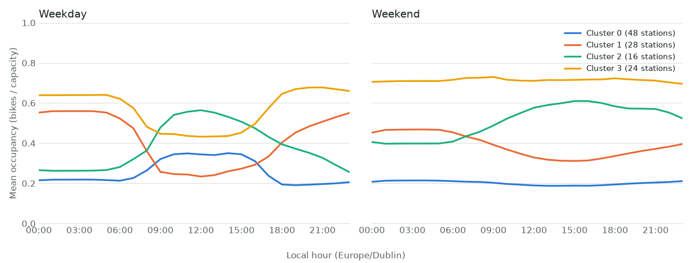
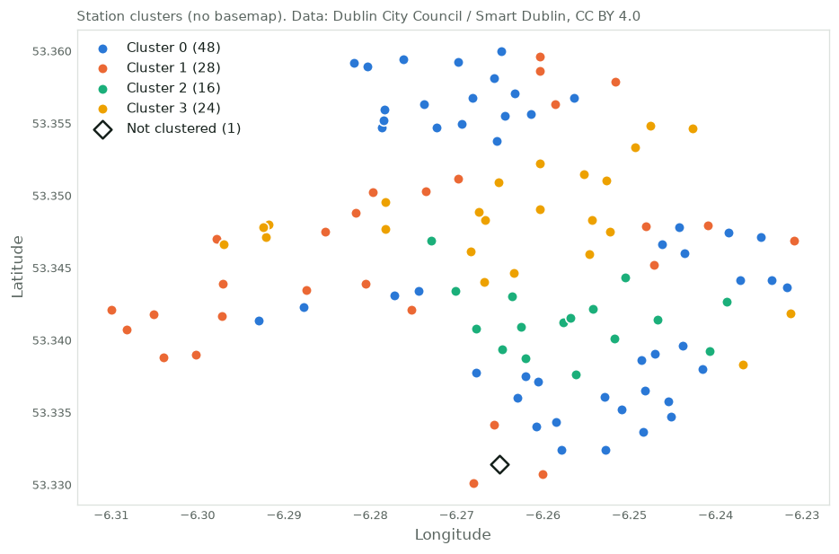
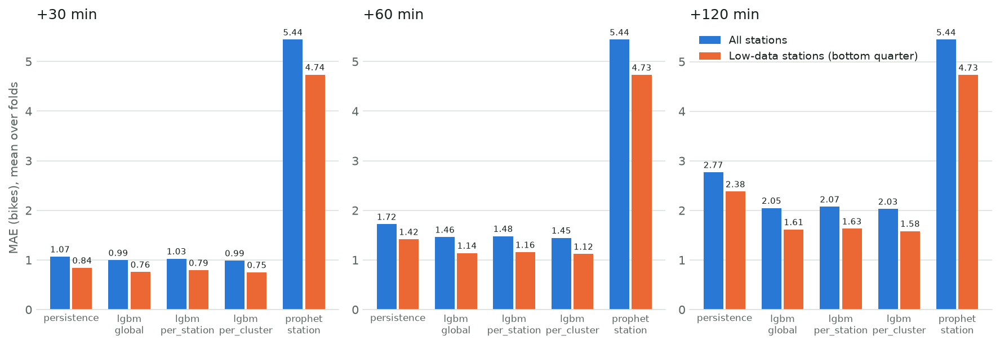

# Experiments

## E1 — ML vs baselines (persistence, seasonal naive 7 d, ridge, LightGBM quantiles)

MLflow run `e4819616d7034b90abcb3adc882313da` · git `ed13e96` · generated 2026-10-30 02:33 UTC · data 2026-04-28 23:45 → 2026-06-30 23:45 UTC

Rolling origin, 8 test weeks on Format B (PRD 9.1a, 13.1; `reports/folds.json`). Training: hourly issue times on all Format B history before each fold, early stopping on the last training week (15-min). Targets: state at t + h; closed, imputed and flat-lined targets excluded; every model scored on the same common rows. Features: lags, rolling, seasonal, calendar, station static (PRD 10.2-10.4); **no weather**. Means over folds (± std of fold MAE). Coverage = share inside P10-P90 (target 80 %).

| horizon | model | MAE | ± | RMSE | MASE | bias | coverage P10-P90 | width | rows |
|---:|---|---:|---:|---:|---:|---:|---:|---:|---:|
| +30 | lgbm_global | 0.995 | 0.050 | 1.988 | 0.933 | -0.002 | 0.825 | 3.10 | 604621 |
| +30 | persistence | 1.066 | 0.058 | 2.218 | 1.000 | +0.000 | — | — | 604621 |
| +30 | ridge | 1.179 | 0.043 | 2.135 | 1.108 | +0.025 | — | — | 604621 |
| +30 | seasonal_naive_7d | 6.355 | 0.552 | 8.689 | 5.993 | -0.022 | — | — | 604621 |
| +60 | lgbm_global | 1.461 | 0.061 | 2.688 | 0.849 | -0.042 | 0.814 | 4.59 | 602561 |
| +60 | persistence | 1.721 | 0.087 | 3.326 | 1.000 | +0.001 | — | — | 602561 |
| +60 | ridge | 1.869 | 0.056 | 3.104 | 1.087 | +0.017 | — | — | 602561 |
| +60 | seasonal_naive_7d | 6.354 | 0.549 | 8.688 | 3.708 | -0.022 | — | — | 602561 |
| +120 | lgbm_global | 2.047 | 0.075 | 3.446 | 0.740 | -0.099 | 0.797 | 6.44 | 598447 |
| +120 | persistence | 2.768 | 0.141 | 4.989 | 1.000 | +0.002 | — | — | 598447 |
| +120 | ridge | 2.874 | 0.076 | 4.344 | 1.040 | +0.025 | — | — | 598447 |
| +120 | seasonal_naive_7d | 6.354 | 0.544 | 8.688 | 2.306 | -0.021 | — | — | 598447 |

**Champion per horizon (PRD 12.5):**

- +30: `lgbm_global` (MAE 0.995, coverage 0.825; lowest MAE with coverage in range)
- +60: `lgbm_global` (MAE 1.461, coverage 0.814; lowest MAE with coverage in range)
- +120: `lgbm_global` (MAE 2.047, coverage 0.797; lowest MAE with coverage in range)

**S1** (+60 MAE <= 0.85 x persistence = 1.463): lgbm_global 1.461 -> **met** (MASE 0.849).

LightGBM boosters that used all 2000 rounds without early stopping: 51 of 72 (PRD 12.3 defaults; tuning is a v2 task).

Test rows per horizon (all folds), issued / valid target / common:

- +30: 617320 / 608186 / 604621
- +60: 615480 / 606358 / 602561
- +120: 611800 / 602702 / 598447

MAE by slice at +60 (mean over folds):

| slice | value | lgbm_global | persistence | ridge | seasonal_naive_7d |
|---|---|---:|---:|---:|---:|
| rush_hour | other | 1.203 | 1.271 | 1.549 | 6.337 |
| rush_hour | rush | 2.235 | 3.075 | 2.831 | 6.407 |
| weekend | weekday | 1.596 | 1.955 | 2.030 | 6.313 |
| weekend | weekend | 1.127 | 1.145 | 1.473 | 6.457 |
| capacity_band | 20-29 | 1.382 | 1.515 | 1.669 | 5.089 |
| capacity_band | 30-39 | 1.454 | 1.736 | 1.875 | 6.527 |
| capacity_band | 40+ | 1.539 | 1.874 | 2.028 | 7.206 |
| capacity_band | <20 | 1.126 | 1.225 | 1.322 | 3.253 |
| rebalance | flagged | 11.307 | 13.156 | 12.220 | 8.848 |
| rebalance | normal | 1.394 | 1.643 | 1.798 | 6.337 |

| fold | train end (UTC) | test start (UTC) | test end (UTC) |
|---:|---|---|---|
| 1 | 2026-05-05 21:45 | 2026-05-05 23:45 | 2026-05-12 23:45 |
| 2 | 2026-05-12 21:45 | 2026-05-12 23:45 | 2026-05-19 23:45 |
| 3 | 2026-05-19 21:45 | 2026-05-19 23:45 | 2026-05-26 23:45 |
| 4 | 2026-05-26 21:45 | 2026-05-26 23:45 | 2026-06-02 23:45 |
| 5 | 2026-06-02 21:45 | 2026-06-02 23:45 | 2026-06-09 23:45 |
| 6 | 2026-06-09 21:45 | 2026-06-09 23:45 | 2026-06-16 23:45 |
| 7 | 2026-06-16 21:45 | 2026-06-16 23:45 | 2026-06-23 23:45 |
| 8 | 2026-06-23 21:45 | 2026-06-23 23:45 | 2026-06-30 23:45 |

## E3 — Station behaviour groups (k-means, Ward)

MLflow run `9f7a9d468a8a422b82b98fb0d2a64ffa` · git `a244419` · generated 2026-10-30 15:22 UTC · data 2021-09-30 23:00 → 2026-06-30 23:45 UTC

Profiles: mean occupancy (bikes / capacity in force) per local hour, weekdays (Mon-Fri) and weekends (Sat-Sun) separately, 48 values per station; observed, open, non-imputed, non-flat-lined 15-min states of Format A + B (PRD 9.1a). Stations with any cell under 20 states are left out. K-means (n_init 20, seed 0) for k = 3-8; Ward at the same k. k is chosen by silhouette on the final profiles (data to the end of the last E1 test week).

Stability: **fold ARI** = pairwise adjusted Rand index of labels fitted on data before each of the 8 E1 fold training ends (folds differ by one week on top of years of data, so this is expected to be high); **period ARI** = labels from Format A only (2021-09 to 2024-02) vs Format B only (2024-05 to 2026-06), on stations in both: the stronger test.

| k | silhouette | fold ARI mean | fold ARI min | period ARI (A vs B) | k-means vs Ward ARI |
|---:|---:|---:|---:|---:|---:|
| 3 | 0.330 | 0.900 | 0.751 | 0.364 | 0.516 |
| 4 **(chosen)** | 0.367 | 0.992 | 0.984 | 0.530 | 0.433 |
| 5 | 0.325 | 0.936 | 0.870 | 0.428 | 0.406 |
| 6 | 0.317 | 0.784 | 0.619 | 0.438 | 0.665 |
| 7 | 0.318 | 0.981 | 0.939 | 0.398 | 0.662 |
| 8 | 0.322 | 0.991 | 0.964 | 0.446 | 0.687 |

Stations clustered: 116; period ARI on 114 stations in both formats. Left out: STATION118 (115).

At k = 4: fold ARI 0.992 (min 0.984); period ARI 0.530, so groups fitted on Format A only partly match those fitted on Format B; k-means and Ward agree at ARI 0.433.

Clusters at k = 4 (ids ordered by mean occupancy; mean over member stations):

| cluster | stations | weekday mean | weekday 08:00 | weekday 18:00 | weekend mean | closest to centre |
|---:|---:|---:|---:|---:|---:|---|
| 0 | 48 | 0.26 | 0.26 | 0.19 | 0.20 | MERRION SQUARE SOUTH; NEWMAN HOUSE; FITZWILLIAM SQUARE WEST |
| 1 | 28 | 0.42 | 0.36 | 0.40 | 0.39 | ROYAL HOSPITAL; GEORGES LANE; ROTHE ABBEY |
| 2 | 16 | 0.38 | 0.36 | 0.39 | 0.51 | YORK STREET EAST; FREDERICK STREET SOUTH; LEINSTER STREET SOUTH |
| 3 | 24 | 0.57 | 0.48 | 0.65 | 0.71 | TALBOT STREET; CUSTOM HOUSE; CATHAL BRUGHA STREET |

Cluster labels describe historical occupancy only; they are not inferred trip purposes. Per-fold labels for later experiments are fitted in-fold (PRD 19.2).

## E4 — Spatial features (A: no spatial vs B: + neighbours)

MLflow run `a972985884564e83aa5b120428bd5c74` · git `ee3679f` · generated 2026-10-30 23:56 UTC · data 2026-05-05 23:45 → 2026-06-30 23:45 UTC

A = `lgbm_global` from E1 run `e4819616d7034b90abcb3adc882313da` (same folds, rows and training). B = the same model plus PRD 10.5 neighbour features: the 5 nearest stations within the radius (haversine); neighbours' mean occupancy ratio and mean change over the last hour, neighbours with 0 bikes, total bikes at every station within the radius, inverse-distance-weighted mean ratio; all read at or before the issue time. Scored on rows common to E1 and E4. Cluster slice: E3 run `9f7a9d468a8a422b82b98fb0d2a64ffa`, labels fitted in-fold. Radii per horizon (owner decision 2026-10-30, to fit the compute budget): +30: 600 m; +60: 400 m / 600 m / 800 m; +120: 600 m. **No weather.** Every radius run is reported; none is selected on the test weeks.

| horizon | model | MAE | ± | MASE | bias | coverage P10-P90 | width | rows |
|---:|---|---:|---:|---:|---:|---:|---:|---:|
| +30 | lgbm_spatial_600 | 0.990 | 0.049 | 0.930 | -0.002 | 0.823 | 3.09 | 604621 |
| +30 | lgbm_global | 0.995 | 0.050 | 0.933 | -0.002 | 0.825 | 3.10 | 604621 |
| +30 | persistence | 1.066 | 0.058 | 1.000 | +0.000 | — | — | 604621 |
| +60 | lgbm_spatial_400 | 1.455 | 0.060 | 0.846 | -0.037 | 0.812 | 4.59 | 602561 |
| +60 | lgbm_spatial_800 | 1.455 | 0.060 | 0.846 | -0.038 | 0.812 | 4.58 | 602561 |
| +60 | lgbm_spatial_600 | 1.456 | 0.061 | 0.846 | -0.036 | 0.811 | 4.58 | 602561 |
| +60 | lgbm_global | 1.461 | 0.061 | 0.849 | -0.042 | 0.814 | 4.59 | 602561 |
| +60 | persistence | 1.721 | 0.087 | 1.000 | +0.001 | — | — | 602561 |
| +120 | lgbm_spatial_600 | 2.041 | 0.078 | 0.738 | -0.098 | 0.797 | 6.38 | 598447 |
| +120 | lgbm_global | 2.047 | 0.075 | 0.740 | -0.099 | 0.797 | 6.44 | 598447 |
| +120 | persistence | 2.768 | 0.141 | 1.000 | +0.002 | — | — | 598447 |

Folds where B beats A (overall MAE), per horizon:

- +30: lgbm_spatial_600: 8/8
- +60: lgbm_spatial_400: 7/8, lgbm_spatial_600: 7/8, lgbm_spatial_800: 8/8
- +120: lgbm_spatial_600: 7/8

ΔMAE (B - A, bikes; negative = B better) by slice at +30, mean over folds:

| slice | value | rows | MAE A | Δ 600 m |
|---|---|---:|---:|---:|
| overall | all | 604621 | 0.995 | -0.004 |
| rush_hour | other | 454115 | 0.791 | -0.002 |
| rush_hour | rush | 150506 | 1.611 | -0.010 |
| weekend | weekday | 430760 | 1.094 | -0.005 |
| weekend | weekend | 173861 | 0.749 | -0.003 |
| capacity_band | 20-29 | 152074 | 0.966 | -0.004 |
| capacity_band | 30-39 | 222563 | 0.981 | -0.003 |
| capacity_band | 40+ | 219374 | 1.037 | -0.006 |
| capacity_band | <20 | 10610 | 0.814 | -0.006 |
| rebalance | flagged | 4094 | 11.692 | -0.100 |
| rebalance | normal | 600527 | 0.922 | -0.004 |
| cluster | 0 | 250569 | 0.795 | -0.003 |
| cluster | 1 | 145695 | 1.061 | -0.004 |
| cluster | 2 | 86632 | 1.130 | -0.005 |
| cluster | 3 | 121725 | 1.230 | -0.006 |

ΔMAE (B - A, bikes; negative = B better) by slice at +60, mean over folds:

| slice | value | rows | MAE A | Δ 400 m | Δ 600 m | Δ 800 m |
|---|---|---:|---:|---:|---:|---:|
| overall | all | 602561 | 1.461 | -0.006 | -0.005 | -0.005 |
| rush_hour | other | 452061 | 1.203 | -0.004 | -0.003 | -0.004 |
| rush_hour | rush | 150500 | 2.235 | -0.009 | -0.011 | -0.011 |
| weekend | weekday | 428702 | 1.596 | -0.006 | -0.006 | -0.006 |
| weekend | weekend | 173859 | 1.127 | -0.004 | -0.003 | -0.003 |
| capacity_band | 20-29 | 151551 | 1.382 | -0.006 | -0.006 | -0.006 |
| capacity_band | 30-39 | 221809 | 1.454 | -0.004 | -0.004 | -0.004 |
| capacity_band | 40+ | 218627 | 1.539 | -0.007 | -0.006 | -0.006 |
| capacity_band | <20 | 10574 | 1.126 | -0.007 | -0.003 | -0.007 |
| rebalance | flagged | 4092 | 11.307 | -0.040 | -0.046 | -0.032 |
| rebalance | normal | 598469 | 1.394 | -0.005 | -0.005 | -0.005 |
| cluster | 0 | 249716 | 1.188 | -0.005 | -0.005 | -0.006 |
| cluster | 1 | 145197 | 1.567 | -0.005 | -0.006 | -0.006 |
| cluster | 2 | 86335 | 1.661 | -0.009 | -0.006 | -0.006 |
| cluster | 3 | 121313 | 1.753 | -0.004 | -0.004 | -0.005 |

ΔMAE (B - A, bikes; negative = B better) by slice at +120, mean over folds:

| slice | value | rows | MAE A | Δ 600 m |
|---|---|---:|---:|---:|
| overall | all | 598447 | 2.047 | -0.006 |
| rush_hour | other | 447955 | 1.776 | -0.006 |
| rush_hour | rush | 150492 | 2.854 | -0.008 |
| weekend | weekday | 424590 | 2.229 | -0.006 |
| weekend | weekend | 173857 | 1.604 | -0.007 |
| capacity_band | 20-29 | 150509 | 1.879 | -0.011 |
| capacity_band | 30-39 | 220301 | 2.065 | -0.002 |
| capacity_band | 40+ | 217135 | 2.172 | -0.007 |
| capacity_band | <20 | 10502 | 1.472 | -0.017 |
| rebalance | flagged | 4081 | 10.347 | -0.031 |
| rebalance | normal | 594366 | 1.990 | -0.006 |
| cluster | 0 | 248014 | 1.688 | -0.005 |
| cluster | 1 | 144201 | 2.216 | -0.003 |
| cluster | 2 | 85743 | 2.322 | -0.011 |
| cluster | 3 | 120489 | 2.387 | -0.009 |

## E2 — Global vs per-station vs per-cluster models, and Prophet

MLflow run `470f72791f044cd39a6a9afd2a061cfd` · git `80cd9df` · generated 2026-10-31 09:27 UTC · data 2026-05-05 23:45 → 2026-06-30 23:45 UTC

`lgbm_global` = E1 run `e4819616d7034b90abcb3adc882313da` (same folds, rows and training). `lgbm_per_station` and `lgbm_per_cluster` use the same features, LightGBM defaults and early stopping, trained on one station's or one cluster's rows; clusters from E3 run `9f7a9d468a8a422b82b98fb0d2a64ffa`, fitted before each fold. `prophet_station`: per station, daily + weekly seasonality and public holidays, fitted once per fold on hourly observed states before the training end, so it does not see the state at the issue time; P10-P90 is Prophet's 80% interval. All stations were run (the full run was under the 2 h limit of PRD 12.2). Scored on rows common to E1 and E2. **No weather.**

| horizon | model | MAE | ± | MASE | bias | coverage P10-P90 | width | rows |
|---:|---|---:|---:|---:|---:|---:|---:|---:|
| +30 | lgbm_per_cluster | 0.987 | 0.048 | 0.926 | +0.001 | 0.807 | 3.06 | 604621 |
| +30 | lgbm_global | 0.995 | 0.050 | 0.933 | -0.002 | 0.825 | 3.10 | 604621 |
| +30 | lgbm_per_station | 1.025 | 0.045 | 0.962 | -0.003 | 0.761 | 3.07 | 604621 |
| +30 | persistence | 1.066 | 0.058 | 1.000 | +0.000 | — | — | 604621 |
| +30 | prophet_station | 5.441 | 0.237 | 5.123 | +0.021 | 0.800 | 15.67 | 604621 |
| +60 | lgbm_per_cluster | 1.445 | 0.058 | 0.840 | -0.043 | 0.798 | 4.45 | 602561 |
| +60 | lgbm_global | 1.461 | 0.061 | 0.849 | -0.042 | 0.814 | 4.59 | 602561 |
| +60 | lgbm_per_station | 1.480 | 0.054 | 0.860 | -0.042 | 0.762 | 4.46 | 602561 |
| +60 | persistence | 1.721 | 0.087 | 1.000 | +0.001 | — | — | 602561 |
| +60 | prophet_station | 5.441 | 0.235 | 3.171 | +0.022 | 0.801 | 15.68 | 602561 |
| +120 | lgbm_per_cluster | 2.028 | 0.075 | 0.733 | -0.097 | 0.785 | 6.26 | 598447 |
| +120 | lgbm_global | 2.047 | 0.075 | 0.740 | -0.099 | 0.797 | 6.44 | 598447 |
| +120 | lgbm_per_station | 2.074 | 0.070 | 0.750 | -0.101 | 0.751 | 6.25 | 598447 |
| +120 | persistence | 2.768 | 0.141 | 1.000 | +0.002 | — | — | 598447 |
| +120 | prophet_station | 5.443 | 0.234 | 1.973 | +0.024 | 0.801 | 15.68 | 598447 |

Low-data stations: per fold and horizon, the 25% of stations with the fewest training rows (29-29 of 115 stations). Within a fold, the busiest low-data station and the least-served other station differ by 1-10 training rows (cut-offs 16096-17265 rows), so the boundary is close to arbitrary: the stations either side of it have almost the same history length (definition under owner review).

MAE by data amount, mean over folds (folds where the model beats `lgbm_global` on that slice in brackets):

| horizon | model | all stations | low-data | rest |
|---:|---|---:|---:|---:|
| +30 | lgbm_global | 0.995 | 0.757 | 1.072 |
| +30 | lgbm_per_station | 1.025 (0/8) | 0.793 (0/8) | 1.101 (0/8) |
| +30 | lgbm_per_cluster | 0.987 (7/8) | 0.749 (8/8) | 1.064 (7/8) |
| +30 | prophet_station | 5.441 (0/8) | 4.735 (0/8) | 5.669 (0/8) |
| +60 | lgbm_global | 1.461 | 1.141 | 1.565 |
| +60 | lgbm_per_station | 1.480 (0/8) | 1.156 (0/8) | 1.585 (0/8) |
| +60 | lgbm_per_cluster | 1.445 (8/8) | 1.120 (8/8) | 1.551 (8/8) |
| +60 | prophet_station | 5.441 (0/8) | 4.731 (0/8) | 5.672 (0/8) |
| +120 | lgbm_global | 2.047 | 1.615 | 2.187 |
| +120 | lgbm_per_station | 2.074 (0/8) | 1.630 (2/8) | 2.218 (0/8) |
| +120 | lgbm_per_cluster | 2.028 (8/8) | 1.584 (8/8) | 2.173 (8/8) |
| +120 | prophet_station | 5.443 (0/8) | 4.731 (0/8) | 5.674 (0/8) |

ΔMAE (model - `lgbm_global`, bikes; negative = better) by slice, mean over folds:

| horizon | slice | value | MAE global | Δ per-station | Δ per-cluster | Δ Prophet |
|---:|---|---|---:|---:|---:|---:|
| +30 | rush_hour | other | 0.791 | +0.036 | -0.004 | +4.635 |
| +30 | rush_hour | rush | 1.611 | +0.015 | -0.021 | +3.877 |
| +30 | weekend | weekday | 1.094 | +0.025 | -0.010 | +4.266 |
| +30 | weekend | weekend | 0.749 | +0.045 | -0.003 | +4.894 |
| +30 | capacity_band | 20-29 | 0.966 | +0.016 | -0.008 | +3.195 |
| +30 | capacity_band | 30-39 | 0.981 | +0.029 | -0.006 | +4.607 |
| +30 | capacity_band | 40+ | 1.037 | +0.043 | -0.009 | +5.279 |
| +30 | capacity_band | <20 | 0.814 | +0.002 | -0.009 | +1.775 |
| +30 | rebalance | flagged | 11.692 | -0.446 | -0.238 | -4.211 |
| +30 | rebalance | normal | 0.922 | +0.034 | -0.006 | +4.505 |
| +30 | cluster | 0 | 0.795 | +0.032 | -0.003 | +3.807 |
| +30 | cluster | 1 | 1.061 | +0.037 | -0.012 | +5.422 |
| +30 | cluster | 2 | 1.130 | +0.027 | -0.010 | +4.533 |
| +30 | cluster | 3 | 1.230 | +0.022 | -0.011 | +4.533 |
| +30 | data_amount | low | 0.757 | +0.035 | -0.008 | +3.978 |
| +30 | data_amount | rest | 1.072 | +0.029 | -0.008 | +4.597 |
| +60 | rush_hour | other | 1.203 | +0.028 | -0.009 | +4.223 |
| +60 | rush_hour | rush | 2.235 | -0.009 | -0.035 | +3.253 |
| +60 | weekend | weekday | 1.596 | +0.011 | -0.018 | +3.764 |
| +60 | weekend | weekend | 1.127 | +0.039 | -0.009 | +4.516 |
| +60 | capacity_band | 20-29 | 1.382 | +0.015 | -0.012 | +2.781 |
| +60 | capacity_band | 30-39 | 1.454 | +0.023 | -0.012 | +4.135 |
| +60 | capacity_band | 40+ | 1.539 | +0.018 | -0.022 | +4.778 |
| +60 | capacity_band | <20 | 1.126 | -0.001 | -0.012 | +1.461 |
| +60 | rebalance | flagged | 11.307 | -0.596 | -0.191 | -3.827 |
| +60 | rebalance | normal | 1.394 | +0.023 | -0.014 | +4.034 |
| +60 | cluster | 0 | 1.188 | +0.017 | -0.012 | +3.415 |
| +60 | cluster | 1 | 1.567 | +0.036 | -0.017 | +4.916 |
| +60 | cluster | 2 | 1.661 | +0.012 | -0.020 | +4.006 |
| +60 | cluster | 3 | 1.753 | +0.007 | -0.017 | +4.011 |
| +60 | data_amount | low | 1.141 | +0.016 | -0.021 | +3.590 |
| +60 | data_amount | rest | 1.565 | +0.020 | -0.014 | +4.107 |
| +120 | rush_hour | other | 1.776 | +0.034 | -0.016 | +3.652 |
| +120 | rush_hour | rush | 2.854 | +0.005 | -0.026 | +2.633 |
| +120 | weekend | weekday | 2.229 | +0.016 | -0.023 | +3.134 |
| +120 | weekend | weekend | 1.604 | +0.055 | -0.008 | +4.039 |
| +120 | capacity_band | 20-29 | 1.879 | +0.016 | -0.014 | +2.285 |
| +120 | capacity_band | 30-39 | 2.065 | +0.038 | -0.017 | +3.525 |
| +120 | capacity_band | 40+ | 2.172 | +0.024 | -0.024 | +4.147 |
| +120 | capacity_band | <20 | 1.472 | +0.003 | -0.011 | +1.110 |
| +120 | rebalance | flagged | 10.347 | -0.548 | -0.095 | -2.862 |
| +120 | rebalance | normal | 1.990 | +0.031 | -0.018 | +3.439 |
| +120 | cluster | 0 | 1.688 | +0.027 | -0.013 | +2.916 |
| +120 | cluster | 1 | 2.216 | +0.051 | -0.018 | +4.265 |
| +120 | cluster | 2 | 2.322 | +0.008 | -0.027 | +3.353 |
| +120 | cluster | 3 | 2.387 | +0.010 | -0.025 | +3.378 |
| +120 | data_amount | low | 1.615 | +0.015 | -0.031 | +3.116 |
| +120 | data_amount | rest | 2.187 | +0.031 | -0.014 | +3.487 |
