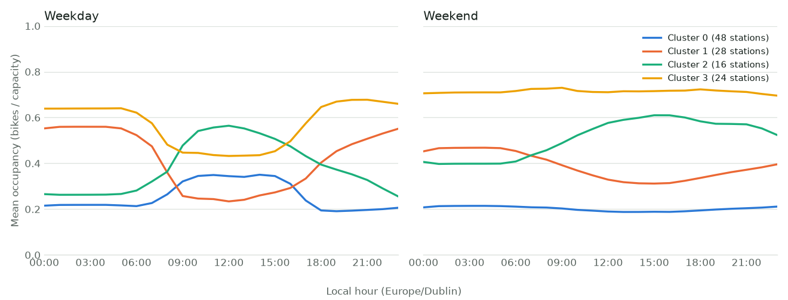
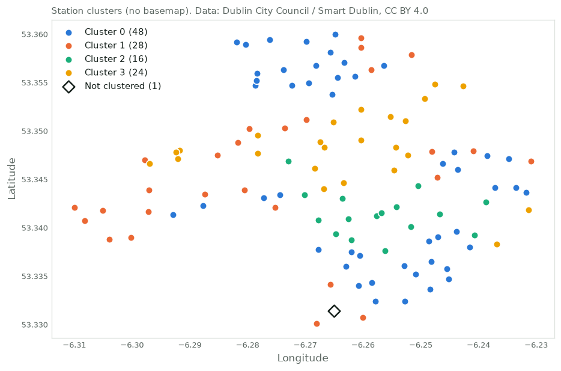
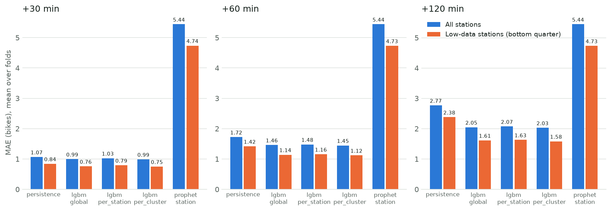
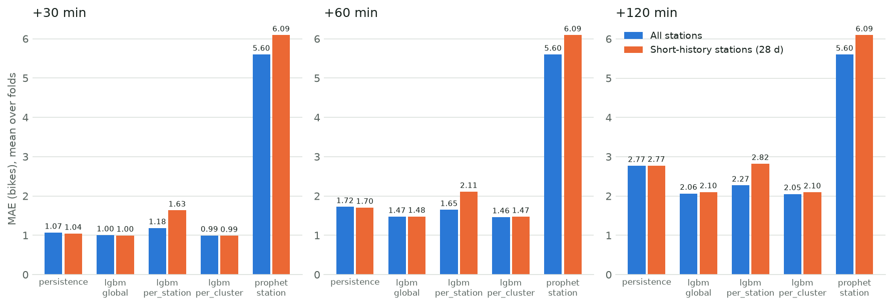
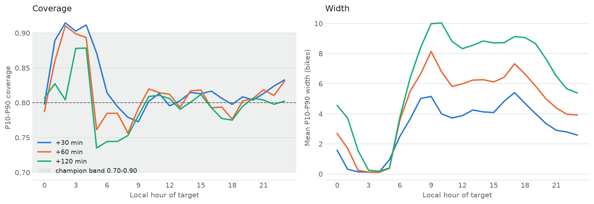
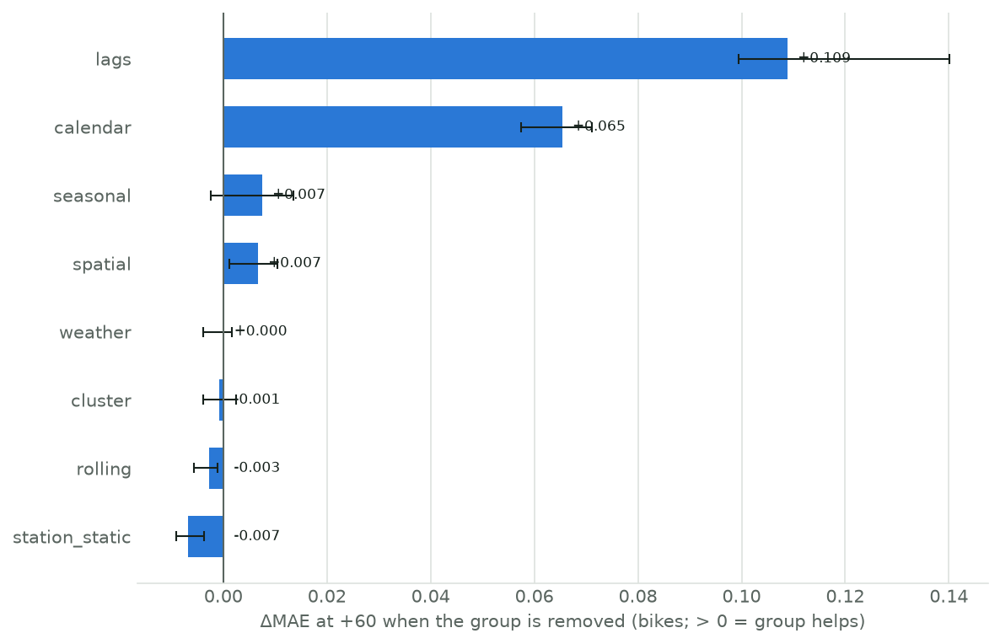
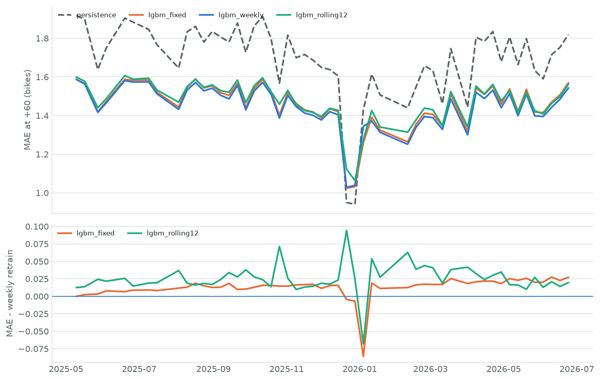

# Experiments

## E1 — ML vs baselines (persistence, seasonal naive 7 d, ridge, LightGBM quantiles)

MLflow run `e4819616d7034b90abcb3adc882313da` · git `ed13e96` · generated 2026-10-30 02:33 UTC · data 2026-04-28 23:45 → 2026-06-30 23:45 UTC

Rolling origin, 8 test weeks on Format B (PRD 9.1a, 13.1; `reports/folds.json`). Training: hourly issue times on all Format B history before each fold, early stopping on the last training week (15-min). Targets: state at t + h; closed, imputed and flat-lined targets excluded; every model scored on the same common rows. Features: lags, rolling, seasonal, calendar, station static (PRD 10.2-10.4); **no weather**. Means over folds (± std of fold MAE). Coverage = share inside P10-P90 (target 80 %).

| horizon | model | MAE | ± | RMSE | MASE | bias | coverage P10-P90 | width | rows |
|---:|---|---:|---:|---:|---:|---:|---:|---:|---:|
| +30 | lgbm_global | 0.995 | 0.050 | 1.988 | 0.933 | -0.002 | 0.825 | 3.10 | 604621 |
| +30 | persistence | 1.066 | 0.058 | 2.218 | 1.000 | +0.000 | — | — | 604621 |
| +30 | ridge | 1.179 | 0.043 | 2.135 | 1.108 | +0.025 | — | — | 604621 |
| +30 | seasonal_naive_7d | 6.355 | 0.552 | 8.689 | 5.993 | -0.022 | — | — | 604621 |
| +60 | lgbm_global | 1.461 | 0.061 | 2.688 | 0.849 | -0.042 | 0.814 | 4.59 | 602561 |
| +60 | persistence | 1.721 | 0.087 | 3.326 | 1.000 | +0.001 | — | — | 602561 |
| +60 | ridge | 1.869 | 0.056 | 3.104 | 1.087 | +0.017 | — | — | 602561 |
| +60 | seasonal_naive_7d | 6.354 | 0.549 | 8.688 | 3.708 | -0.022 | — | — | 602561 |
| +120 | lgbm_global | 2.047 | 0.075 | 3.446 | 0.740 | -0.099 | 0.797 | 6.44 | 598447 |
| +120 | persistence | 2.768 | 0.141 | 4.989 | 1.000 | +0.002 | — | — | 598447 |
| +120 | ridge | 2.874 | 0.076 | 4.344 | 1.040 | +0.025 | — | — | 598447 |
| +120 | seasonal_naive_7d | 6.354 | 0.544 | 8.688 | 2.306 | -0.021 | — | — | 598447 |

**Champion per horizon (PRD 12.5):**

- +30: `lgbm_global` (MAE 0.995, coverage 0.825; lowest MAE with coverage in range)
- +60: `lgbm_global` (MAE 1.461, coverage 0.814; lowest MAE with coverage in range)
- +120: `lgbm_global` (MAE 2.047, coverage 0.797; lowest MAE with coverage in range)

**S1** (+60 MAE <= 0.85 x persistence = 1.463): lgbm_global 1.461 -> **met** (MASE 0.849).

LightGBM boosters that used all 2000 rounds without early stopping: 51 of 72 (PRD 12.3 defaults; tuning is a v2 task).

Test rows per horizon (all folds), issued / valid target / common:

- +30: 617320 / 608186 / 604621
- +60: 615480 / 606358 / 602561
- +120: 611800 / 602702 / 598447

MAE by slice at +60 (mean over folds):

| slice | value | lgbm_global | persistence | ridge | seasonal_naive_7d |
|---|---|---:|---:|---:|---:|
| rush_hour | other | 1.203 | 1.271 | 1.549 | 6.337 |
| rush_hour | rush | 2.235 | 3.075 | 2.831 | 6.407 |
| weekend | weekday | 1.596 | 1.955 | 2.030 | 6.313 |
| weekend | weekend | 1.127 | 1.145 | 1.473 | 6.457 |
| capacity_band | 20-29 | 1.382 | 1.515 | 1.669 | 5.089 |
| capacity_band | 30-39 | 1.454 | 1.736 | 1.875 | 6.527 |
| capacity_band | 40+ | 1.539 | 1.874 | 2.028 | 7.206 |
| capacity_band | <20 | 1.126 | 1.225 | 1.322 | 3.253 |
| rebalance | flagged | 11.307 | 13.156 | 12.220 | 8.848 |
| rebalance | normal | 1.394 | 1.643 | 1.798 | 6.337 |

| fold | train end (UTC) | test start (UTC) | test end (UTC) |
|---:|---|---|---|
| 1 | 2026-05-05 21:45 | 2026-05-05 23:45 | 2026-05-12 23:45 |
| 2 | 2026-05-12 21:45 | 2026-05-12 23:45 | 2026-05-19 23:45 |
| 3 | 2026-05-19 21:45 | 2026-05-19 23:45 | 2026-05-26 23:45 |
| 4 | 2026-05-26 21:45 | 2026-05-26 23:45 | 2026-06-02 23:45 |
| 5 | 2026-06-02 21:45 | 2026-06-02 23:45 | 2026-06-09 23:45 |
| 6 | 2026-06-09 21:45 | 2026-06-09 23:45 | 2026-06-16 23:45 |
| 7 | 2026-06-16 21:45 | 2026-06-16 23:45 | 2026-06-23 23:45 |
| 8 | 2026-06-23 21:45 | 2026-06-23 23:45 | 2026-06-30 23:45 |

## E3 — Station behaviour groups (k-means, Ward)

MLflow run `9f7a9d468a8a422b82b98fb0d2a64ffa` · git `a244419` · generated 2026-10-30 15:22 UTC · data 2021-09-30 23:00 → 2026-06-30 23:45 UTC

Profiles: mean occupancy (bikes / capacity in force) per local hour, weekdays (Mon-Fri) and weekends (Sat-Sun) separately, 48 values per station; observed, open, non-imputed, non-flat-lined 15-min states of Format A + B (PRD 9.1a). Stations with any cell under 20 states are left out. K-means (n_init 20, seed 0) for k = 3-8; Ward at the same k. k is chosen by silhouette on the final profiles (data to the end of the last E1 test week).

Stability: **fold ARI** = pairwise adjusted Rand index of labels fitted on data before each of the 8 E1 fold training ends (folds differ by one week on top of years of data, so this is expected to be high); **period ARI** = labels from Format A only (2021-09 to 2024-02) vs Format B only (2024-05 to 2026-06), on stations in both: the stronger test.

| k | silhouette | fold ARI mean | fold ARI min | period ARI (A vs B) | k-means vs Ward ARI |
|---:|---:|---:|---:|---:|---:|
| 3 | 0.330 | 0.900 | 0.751 | 0.364 | 0.516 |
| 4 **(chosen)** | 0.367 | 0.992 | 0.984 | 0.530 | 0.433 |
| 5 | 0.325 | 0.936 | 0.870 | 0.428 | 0.406 |
| 6 | 0.317 | 0.784 | 0.619 | 0.438 | 0.665 |
| 7 | 0.318 | 0.981 | 0.939 | 0.398 | 0.662 |
| 8 | 0.322 | 0.991 | 0.964 | 0.446 | 0.687 |

Stations clustered: 116; period ARI on 114 stations in both formats. Left out: STATION118 (115).

At k = 4: fold ARI 0.992 (min 0.984); period ARI 0.530, so groups fitted on Format A only partly match those fitted on Format B; k-means and Ward agree at ARI 0.433.

Clusters at k = 4 (ids ordered by mean occupancy; mean over member stations):

| cluster | stations | weekday mean | weekday 08:00 | weekday 18:00 | weekend mean | closest to centre |
|---:|---:|---:|---:|---:|---:|---|
| 0 | 48 | 0.26 | 0.26 | 0.19 | 0.20 | MERRION SQUARE SOUTH; NEWMAN HOUSE; FITZWILLIAM SQUARE WEST |
| 1 | 28 | 0.42 | 0.36 | 0.40 | 0.39 | ROYAL HOSPITAL; GEORGES LANE; ROTHE ABBEY |
| 2 | 16 | 0.38 | 0.36 | 0.39 | 0.51 | YORK STREET EAST; FREDERICK STREET SOUTH; LEINSTER STREET SOUTH |
| 3 | 24 | 0.57 | 0.48 | 0.65 | 0.71 | TALBOT STREET; CUSTOM HOUSE; CATHAL BRUGHA STREET |

Cluster labels describe historical occupancy only; they are not inferred trip purposes. Per-fold labels for later experiments are fitted in-fold (PRD 19.2).

## E4 — Spatial features (A: no spatial vs B: + neighbours)

MLflow run `a972985884564e83aa5b120428bd5c74` · git `ee3679f` · generated 2026-10-30 23:56 UTC · data 2026-05-05 23:45 → 2026-06-30 23:45 UTC

A = `lgbm_global` from E1 run `e4819616d7034b90abcb3adc882313da` (same folds, rows and training). B = the same model plus PRD 10.5 neighbour features: the 5 nearest stations within the radius (haversine); neighbours' mean occupancy ratio and mean change over the last hour, neighbours with 0 bikes, total bikes at every station within the radius, inverse-distance-weighted mean ratio; all read at or before the issue time. Scored on rows common to E1 and E4. Cluster slice: E3 run `9f7a9d468a8a422b82b98fb0d2a64ffa`, labels fitted in-fold. Radii per horizon (owner decision 2026-10-30, to fit the compute budget): +30: 600 m; +60: 400 m / 600 m / 800 m; +120: 600 m. **No weather.** Every radius run is reported; none is selected on the test weeks.

| horizon | model | MAE | ± | MASE | bias | coverage P10-P90 | width | rows |
|---:|---|---:|---:|---:|---:|---:|---:|---:|
| +30 | lgbm_spatial_600 | 0.990 | 0.049 | 0.930 | -0.002 | 0.823 | 3.09 | 604621 |
| +30 | lgbm_global | 0.995 | 0.050 | 0.933 | -0.002 | 0.825 | 3.10 | 604621 |
| +30 | persistence | 1.066 | 0.058 | 1.000 | +0.000 | — | — | 604621 |
| +60 | lgbm_spatial_400 | 1.455 | 0.060 | 0.846 | -0.037 | 0.812 | 4.59 | 602561 |
| +60 | lgbm_spatial_800 | 1.455 | 0.060 | 0.846 | -0.038 | 0.812 | 4.58 | 602561 |
| +60 | lgbm_spatial_600 | 1.456 | 0.061 | 0.846 | -0.036 | 0.811 | 4.58 | 602561 |
| +60 | lgbm_global | 1.461 | 0.061 | 0.849 | -0.042 | 0.814 | 4.59 | 602561 |
| +60 | persistence | 1.721 | 0.087 | 1.000 | +0.001 | — | — | 602561 |
| +120 | lgbm_spatial_600 | 2.041 | 0.078 | 0.738 | -0.098 | 0.797 | 6.38 | 598447 |
| +120 | lgbm_global | 2.047 | 0.075 | 0.740 | -0.099 | 0.797 | 6.44 | 598447 |
| +120 | persistence | 2.768 | 0.141 | 1.000 | +0.002 | — | — | 598447 |

Folds where B beats A (overall MAE), per horizon:

- +30: lgbm_spatial_600: 8/8
- +60: lgbm_spatial_400: 7/8, lgbm_spatial_600: 7/8, lgbm_spatial_800: 8/8
- +120: lgbm_spatial_600: 7/8

ΔMAE (B - A, bikes; negative = B better) by slice at +30, mean over folds:

| slice | value | rows | MAE A | Δ 600 m |
|---|---|---:|---:|---:|
| overall | all | 604621 | 0.995 | -0.004 |
| rush_hour | other | 454115 | 0.791 | -0.002 |
| rush_hour | rush | 150506 | 1.611 | -0.010 |
| weekend | weekday | 430760 | 1.094 | -0.005 |
| weekend | weekend | 173861 | 0.749 | -0.003 |
| capacity_band | 20-29 | 152074 | 0.966 | -0.004 |
| capacity_band | 30-39 | 222563 | 0.981 | -0.003 |
| capacity_band | 40+ | 219374 | 1.037 | -0.006 |
| capacity_band | <20 | 10610 | 0.814 | -0.006 |
| rebalance | flagged | 4094 | 11.692 | -0.100 |
| rebalance | normal | 600527 | 0.922 | -0.004 |
| cluster | 0 | 250569 | 0.795 | -0.003 |
| cluster | 1 | 145695 | 1.061 | -0.004 |
| cluster | 2 | 86632 | 1.130 | -0.005 |
| cluster | 3 | 121725 | 1.230 | -0.006 |

ΔMAE (B - A, bikes; negative = B better) by slice at +60, mean over folds:

| slice | value | rows | MAE A | Δ 400 m | Δ 600 m | Δ 800 m |
|---|---|---:|---:|---:|---:|---:|
| overall | all | 602561 | 1.461 | -0.006 | -0.005 | -0.005 |
| rush_hour | other | 452061 | 1.203 | -0.004 | -0.003 | -0.004 |
| rush_hour | rush | 150500 | 2.235 | -0.009 | -0.011 | -0.011 |
| weekend | weekday | 428702 | 1.596 | -0.006 | -0.006 | -0.006 |
| weekend | weekend | 173859 | 1.127 | -0.004 | -0.003 | -0.003 |
| capacity_band | 20-29 | 151551 | 1.382 | -0.006 | -0.006 | -0.006 |
| capacity_band | 30-39 | 221809 | 1.454 | -0.004 | -0.004 | -0.004 |
| capacity_band | 40+ | 218627 | 1.539 | -0.007 | -0.006 | -0.006 |
| capacity_band | <20 | 10574 | 1.126 | -0.007 | -0.003 | -0.007 |
| rebalance | flagged | 4092 | 11.307 | -0.040 | -0.046 | -0.032 |
| rebalance | normal | 598469 | 1.394 | -0.005 | -0.005 | -0.005 |
| cluster | 0 | 249716 | 1.188 | -0.005 | -0.005 | -0.006 |
| cluster | 1 | 145197 | 1.567 | -0.005 | -0.006 | -0.006 |
| cluster | 2 | 86335 | 1.661 | -0.009 | -0.006 | -0.006 |
| cluster | 3 | 121313 | 1.753 | -0.004 | -0.004 | -0.005 |

ΔMAE (B - A, bikes; negative = B better) by slice at +120, mean over folds:

| slice | value | rows | MAE A | Δ 600 m |
|---|---|---:|---:|---:|
| overall | all | 598447 | 2.047 | -0.006 |
| rush_hour | other | 447955 | 1.776 | -0.006 |
| rush_hour | rush | 150492 | 2.854 | -0.008 |
| weekend | weekday | 424590 | 2.229 | -0.006 |
| weekend | weekend | 173857 | 1.604 | -0.007 |
| capacity_band | 20-29 | 150509 | 1.879 | -0.011 |
| capacity_band | 30-39 | 220301 | 2.065 | -0.002 |
| capacity_band | 40+ | 217135 | 2.172 | -0.007 |
| capacity_band | <20 | 10502 | 1.472 | -0.017 |
| rebalance | flagged | 4081 | 10.347 | -0.031 |
| rebalance | normal | 594366 | 1.990 | -0.006 |
| cluster | 0 | 248014 | 1.688 | -0.005 |
| cluster | 1 | 144201 | 2.216 | -0.003 |
| cluster | 2 | 85743 | 2.322 | -0.011 |
| cluster | 3 | 120489 | 2.387 | -0.009 |

## E2 — Global vs per-station vs per-cluster models, and Prophet

MLflow run `470f72791f044cd39a6a9afd2a061cfd` · git `80cd9df` · generated 2026-10-31 09:27 UTC · data 2026-05-05 23:45 → 2026-06-30 23:45 UTC

`lgbm_global` = E1 run `e4819616d7034b90abcb3adc882313da` (same folds, rows and training). `lgbm_per_station` and `lgbm_per_cluster` use the same features, LightGBM defaults and early stopping, trained on one station's or one cluster's rows; clusters from E3 run `9f7a9d468a8a422b82b98fb0d2a64ffa`, fitted before each fold. `prophet_station`: per station, daily + weekly seasonality and public holidays, fitted once per fold on hourly observed states before the training end, so it does not see the state at the issue time; P10-P90 is Prophet's 80% interval. All stations were run (the full run was under the 2 h limit of PRD 12.2). Scored on rows common to E1 and E2. **No weather.**

| horizon | model | MAE | ± | MASE | bias | coverage P10-P90 | width | rows |
|---:|---|---:|---:|---:|---:|---:|---:|---:|
| +30 | lgbm_per_cluster | 0.987 | 0.048 | 0.926 | +0.001 | 0.807 | 3.06 | 604621 |
| +30 | lgbm_global | 0.995 | 0.050 | 0.933 | -0.002 | 0.825 | 3.10 | 604621 |
| +30 | lgbm_per_station | 1.025 | 0.045 | 0.962 | -0.003 | 0.761 | 3.07 | 604621 |
| +30 | persistence | 1.066 | 0.058 | 1.000 | +0.000 | — | — | 604621 |
| +30 | prophet_station | 5.441 | 0.237 | 5.123 | +0.021 | 0.800 | 15.67 | 604621 |
| +60 | lgbm_per_cluster | 1.445 | 0.058 | 0.840 | -0.043 | 0.798 | 4.45 | 602561 |
| +60 | lgbm_global | 1.461 | 0.061 | 0.849 | -0.042 | 0.814 | 4.59 | 602561 |
| +60 | lgbm_per_station | 1.480 | 0.054 | 0.860 | -0.042 | 0.762 | 4.46 | 602561 |
| +60 | persistence | 1.721 | 0.087 | 1.000 | +0.001 | — | — | 602561 |
| +60 | prophet_station | 5.441 | 0.235 | 3.171 | +0.022 | 0.801 | 15.68 | 602561 |
| +120 | lgbm_per_cluster | 2.028 | 0.075 | 0.733 | -0.097 | 0.785 | 6.26 | 598447 |
| +120 | lgbm_global | 2.047 | 0.075 | 0.740 | -0.099 | 0.797 | 6.44 | 598447 |
| +120 | lgbm_per_station | 2.074 | 0.070 | 0.750 | -0.101 | 0.751 | 6.25 | 598447 |
| +120 | persistence | 2.768 | 0.141 | 1.000 | +0.002 | — | — | 598447 |
| +120 | prophet_station | 5.443 | 0.234 | 1.973 | +0.024 | 0.801 | 15.68 | 598447 |

Low-data stations: per fold and horizon, the 25% of stations with the fewest training rows (29-29 of 115 stations). Within a fold, the busiest low-data station and the least-served other station differ by 1-10 training rows (cut-offs 16096-17265 rows), so the boundary is close to arbitrary: the stations either side of it have almost the same history length (definition under owner review).

MAE by data amount, mean over folds (folds where the model beats `lgbm_global` on that slice in brackets):

| horizon | model | all stations | low-data | rest |
|---:|---|---:|---:|---:|
| +30 | lgbm_global | 0.995 | 0.757 | 1.072 |
| +30 | lgbm_per_station | 1.025 (0/8) | 0.793 (0/8) | 1.101 (0/8) |
| +30 | lgbm_per_cluster | 0.987 (7/8) | 0.749 (8/8) | 1.064 (7/8) |
| +30 | prophet_station | 5.441 (0/8) | 4.735 (0/8) | 5.669 (0/8) |
| +60 | lgbm_global | 1.461 | 1.141 | 1.565 |
| +60 | lgbm_per_station | 1.480 (0/8) | 1.156 (0/8) | 1.585 (0/8) |
| +60 | lgbm_per_cluster | 1.445 (8/8) | 1.120 (8/8) | 1.551 (8/8) |
| +60 | prophet_station | 5.441 (0/8) | 4.731 (0/8) | 5.672 (0/8) |
| +120 | lgbm_global | 2.047 | 1.615 | 2.187 |
| +120 | lgbm_per_station | 2.074 (0/8) | 1.630 (2/8) | 2.218 (0/8) |
| +120 | lgbm_per_cluster | 2.028 (8/8) | 1.584 (8/8) | 2.173 (8/8) |
| +120 | prophet_station | 5.443 (0/8) | 4.731 (0/8) | 5.674 (0/8) |

ΔMAE (model - `lgbm_global`, bikes; negative = better) by slice, mean over folds:

| horizon | slice | value | MAE global | Δ per-station | Δ per-cluster | Δ Prophet |
|---:|---|---|---:|---:|---:|---:|
| +30 | rush_hour | other | 0.791 | +0.036 | -0.004 | +4.635 |
| +30 | rush_hour | rush | 1.611 | +0.015 | -0.021 | +3.877 |
| +30 | weekend | weekday | 1.094 | +0.025 | -0.010 | +4.266 |
| +30 | weekend | weekend | 0.749 | +0.045 | -0.003 | +4.894 |
| +30 | capacity_band | 20-29 | 0.966 | +0.016 | -0.008 | +3.195 |
| +30 | capacity_band | 30-39 | 0.981 | +0.029 | -0.006 | +4.607 |
| +30 | capacity_band | 40+ | 1.037 | +0.043 | -0.009 | +5.279 |
| +30 | capacity_band | <20 | 0.814 | +0.002 | -0.009 | +1.775 |
| +30 | rebalance | flagged | 11.692 | -0.446 | -0.238 | -4.211 |
| +30 | rebalance | normal | 0.922 | +0.034 | -0.006 | +4.505 |
| +30 | cluster | 0 | 0.795 | +0.032 | -0.003 | +3.807 |
| +30 | cluster | 1 | 1.061 | +0.037 | -0.012 | +5.422 |
| +30 | cluster | 2 | 1.130 | +0.027 | -0.010 | +4.533 |
| +30 | cluster | 3 | 1.230 | +0.022 | -0.011 | +4.533 |
| +30 | data_amount | low | 0.757 | +0.035 | -0.008 | +3.978 |
| +30 | data_amount | rest | 1.072 | +0.029 | -0.008 | +4.597 |
| +60 | rush_hour | other | 1.203 | +0.028 | -0.009 | +4.223 |
| +60 | rush_hour | rush | 2.235 | -0.009 | -0.035 | +3.253 |
| +60 | weekend | weekday | 1.596 | +0.011 | -0.018 | +3.764 |
| +60 | weekend | weekend | 1.127 | +0.039 | -0.009 | +4.516 |
| +60 | capacity_band | 20-29 | 1.382 | +0.015 | -0.012 | +2.781 |
| +60 | capacity_band | 30-39 | 1.454 | +0.023 | -0.012 | +4.135 |
| +60 | capacity_band | 40+ | 1.539 | +0.018 | -0.022 | +4.778 |
| +60 | capacity_band | <20 | 1.126 | -0.001 | -0.012 | +1.461 |
| +60 | rebalance | flagged | 11.307 | -0.596 | -0.191 | -3.827 |
| +60 | rebalance | normal | 1.394 | +0.023 | -0.014 | +4.034 |
| +60 | cluster | 0 | 1.188 | +0.017 | -0.012 | +3.415 |
| +60 | cluster | 1 | 1.567 | +0.036 | -0.017 | +4.916 |
| +60 | cluster | 2 | 1.661 | +0.012 | -0.020 | +4.006 |
| +60 | cluster | 3 | 1.753 | +0.007 | -0.017 | +4.011 |
| +60 | data_amount | low | 1.141 | +0.016 | -0.021 | +3.590 |
| +60 | data_amount | rest | 1.565 | +0.020 | -0.014 | +4.107 |
| +120 | rush_hour | other | 1.776 | +0.034 | -0.016 | +3.652 |
| +120 | rush_hour | rush | 2.854 | +0.005 | -0.026 | +2.633 |
| +120 | weekend | weekday | 2.229 | +0.016 | -0.023 | +3.134 |
| +120 | weekend | weekend | 1.604 | +0.055 | -0.008 | +4.039 |
| +120 | capacity_band | 20-29 | 1.879 | +0.016 | -0.014 | +2.285 |
| +120 | capacity_band | 30-39 | 2.065 | +0.038 | -0.017 | +3.525 |
| +120 | capacity_band | 40+ | 2.172 | +0.024 | -0.024 | +4.147 |
| +120 | capacity_band | <20 | 1.472 | +0.003 | -0.011 | +1.110 |
| +120 | rebalance | flagged | 10.347 | -0.548 | -0.095 | -2.862 |
| +120 | rebalance | normal | 1.990 | +0.031 | -0.018 | +3.439 |
| +120 | cluster | 0 | 1.688 | +0.027 | -0.013 | +2.916 |
| +120 | cluster | 1 | 2.216 | +0.051 | -0.018 | +4.265 |
| +120 | cluster | 2 | 2.322 | +0.008 | -0.027 | +3.353 |
| +120 | cluster | 3 | 2.387 | +0.010 | -0.025 | +3.378 |
| +120 | data_amount | low | 1.615 | +0.015 | -0.031 | +3.116 |
| +120 | data_amount | rest | 2.187 | +0.031 | -0.014 | +3.487 |

## E2b — Low-data stations by truncated history

MLflow run `01131c8fc80b40b0abad2742db60f700` · git `c0143af` · generated 2026-10-31 21:07 UTC · data 2026-05-05 23:45 → 2026-06-30 23:45 UTC

E2's bottom quarter by training rows barely differs from the other stations (every Format B station has almost the full history). Here 29 stations (25%, seeded random, the same in every fold) keep only their last 28 days of training before each fold's validation week: their earlier states are removed, so lags, the station x hour encoding and Prophet see the short history too. Validation week and test window are unchanged. Training rows per short station: 588-672; per full-history station at least 8193. Every model, `lgbm_global` included, is retrained on this data, with E2's features, LightGBM defaults and early stopping. Clusters are E3 run `9f7a9d468a8a422b82b98fb0d2a64ffa`'s in-fold labels, fitted on the full pre-fold history (a real new station would have a less certain cluster). Short stations: 1, 2, 4, 7, 17, 25, 29, 30, 44, 46, 50, 57, 59, 61, 63, 66, 74, 75, 79, 88, 89, 90, 97, 99, 100, 102, 104, 113, 114. **No weather.**

| horizon | model | MAE | ± | MASE | bias | coverage P10-P90 | width | rows |
|---:|---|---:|---:|---:|---:|---:|---:|---:|
| +30 | lgbm_per_cluster | 0.995 | 0.047 | 0.933 | -0.002 | 0.803 | 3.08 | 607950 |
| +30 | lgbm_global | 1.002 | 0.050 | 0.940 | -0.006 | 0.817 | 3.12 | 607950 |
| +30 | persistence | 1.066 | 0.057 | 1.000 | +0.001 | — | — | 607950 |
| +30 | lgbm_per_station | 1.184 | 0.050 | 1.112 | -0.056 | 0.756 | 3.59 | 607950 |
| +30 | prophet_station | 5.598 | 0.324 | 5.271 | -0.001 | 0.767 | 15.06 | 607950 |
| +60 | lgbm_per_cluster | 1.462 | 0.058 | 0.849 | -0.050 | 0.793 | 4.48 | 605888 |
| +60 | lgbm_global | 1.472 | 0.061 | 0.855 | -0.046 | 0.807 | 4.62 | 605888 |
| +60 | lgbm_per_station | 1.647 | 0.061 | 0.958 | -0.086 | 0.756 | 5.06 | 605888 |
| +60 | persistence | 1.722 | 0.086 | 1.000 | +0.001 | — | — | 605888 |
| +60 | prophet_station | 5.599 | 0.323 | 3.263 | +0.001 | 0.768 | 15.07 | 605888 |
| +120 | lgbm_per_cluster | 2.052 | 0.073 | 0.742 | -0.113 | 0.777 | 6.28 | 601770 |
| +120 | lgbm_global | 2.063 | 0.076 | 0.746 | -0.107 | 0.788 | 6.43 | 601770 |
| +120 | lgbm_per_station | 2.270 | 0.079 | 0.821 | -0.147 | 0.744 | 6.94 | 601770 |
| +120 | persistence | 2.769 | 0.141 | 1.000 | +0.002 | — | — | 601770 |
| +120 | prophet_station | 5.601 | 0.322 | 2.030 | +0.002 | 0.767 | 15.07 | 601770 |

MAE by history, mean over folds (folds where the model beats `lgbm_global` on that slice in brackets):

| horizon | model | all stations | short history | full history |
|---:|---|---:|---:|---:|
| +30 | lgbm_global | 1.002 | 0.995 | 1.004 |
| +30 | lgbm_per_station | 1.184 (0/8) | 1.634 (0/8) | 1.033 (0/8) |
| +30 | lgbm_per_cluster | 0.995 (8/8) | 0.987 (8/8) | 0.997 (8/8) |
| +30 | prophet_station | 5.598 (0/8) | 6.090 (0/8) | 5.433 (0/8) |
| +60 | lgbm_global | 1.472 | 1.476 | 1.470 |
| +60 | lgbm_per_station | 1.647 (0/8) | 2.108 (0/8) | 1.493 (0/8) |
| +60 | lgbm_per_cluster | 1.462 (8/8) | 1.471 (6/8) | 1.459 (8/8) |
| +60 | prophet_station | 5.599 (0/8) | 6.091 (0/8) | 5.434 (0/8) |
| +120 | lgbm_global | 2.063 | 2.100 | 2.051 |
| +120 | lgbm_per_station | 2.270 (0/8) | 2.821 (0/8) | 2.085 (0/8) |
| +120 | lgbm_per_cluster | 2.052 (8/8) | 2.096 (4/8) | 2.037 (8/8) |
| +120 | prophet_station | 5.601 (0/8) | 6.093 (0/8) | 5.436 (0/8) |

ΔMAE (model - `lgbm_global`, bikes; negative = better) by slice, mean over folds:

| horizon | slice | value | MAE global | Δ per-station | Δ per-cluster | Δ Prophet |
|---:|---|---|---:|---:|---:|---:|
| +30 | rush_hour | other | 0.794 | +0.196 | -0.003 | +4.789 |
| +30 | rush_hour | rush | 1.625 | +0.141 | -0.019 | +4.017 |
| +30 | weekend | weekday | 1.101 | +0.188 | -0.009 | +4.408 |
| +30 | weekend | weekend | 0.755 | +0.168 | -0.003 | +5.064 |
| +30 | capacity_band | 20-29 | 0.972 | +0.105 | -0.005 | +3.359 |
| +30 | capacity_band | 30-39 | 0.984 | +0.130 | -0.005 | +4.704 |
| +30 | capacity_band | 40+ | 1.050 | +0.296 | -0.010 | +5.481 |
| +30 | capacity_band | <20 | 0.810 | +0.005 | -0.009 | +1.786 |
| +30 | rebalance | flagged | 11.822 | -0.323 | -0.174 | -4.110 |
| +30 | rebalance | normal | 0.928 | +0.185 | -0.006 | +4.655 |
| +30 | cluster | 0 | 0.804 | +0.236 | -0.008 | +3.951 |
| +30 | cluster | 1 | 1.066 | +0.179 | -0.011 | +5.606 |
| +30 | cluster | 2 | 1.133 | +0.161 | -0.002 | +4.803 |
| +30 | cluster | 3 | 1.240 | +0.088 | -0.005 | +4.565 |
| +30 | history | full | 1.004 | +0.029 | -0.007 | +4.429 |
| +30 | history | short | 0.995 | +0.638 | -0.008 | +5.095 |
| +60 | rush_hour | other | 1.209 | +0.182 | -0.005 | +4.376 |
| +60 | rush_hour | rush | 2.258 | +0.156 | -0.023 | +3.383 |
| +60 | weekend | weekday | 1.608 | +0.180 | -0.010 | +3.902 |
| +60 | weekend | weekend | 1.134 | +0.164 | -0.008 | +4.684 |
| +60 | capacity_band | 20-29 | 1.390 | +0.100 | -0.003 | +2.942 |
| +60 | capacity_band | 30-39 | 1.456 | +0.124 | -0.005 | +4.233 |
| +60 | capacity_band | 40+ | 1.562 | +0.287 | -0.018 | +4.970 |
| +60 | capacity_band | <20 | 1.119 | +0.003 | -0.014 | +1.474 |
| +60 | rebalance | flagged | 11.438 | -0.473 | -0.262 | -3.726 |
| +60 | rebalance | normal | 1.403 | +0.180 | -0.008 | +4.181 |
| +60 | cluster | 0 | 1.195 | +0.230 | -0.008 | +3.560 |
| +60 | cluster | 1 | 1.577 | +0.171 | -0.014 | +5.095 |
| +60 | cluster | 2 | 1.663 | +0.142 | +0.002 | +4.276 |
| +60 | cluster | 3 | 1.778 | +0.091 | -0.016 | +4.028 |
| +60 | history | full | 1.470 | +0.022 | -0.011 | +3.964 |
| +60 | history | short | 1.476 | +0.632 | -0.005 | +4.615 |
| +120 | rush_hour | other | 1.785 | +0.209 | -0.008 | +3.802 |
| +120 | rush_hour | rush | 2.889 | +0.201 | -0.020 | +2.752 |
| +120 | weekend | weekday | 2.246 | +0.205 | -0.014 | +3.265 |
| +120 | weekend | weekend | 1.614 | +0.212 | -0.006 | +4.205 |
| +120 | capacity_band | 20-29 | 1.892 | +0.112 | -0.002 | +2.441 |
| +120 | capacity_band | 30-39 | 2.066 | +0.154 | -0.009 | +3.624 |
| +120 | capacity_band | 40+ | 2.208 | +0.336 | -0.021 | +4.327 |
| +120 | capacity_band | <20 | 1.462 | +0.009 | -0.005 | +1.127 |
| +120 | rebalance | flagged | 10.323 | -0.360 | -0.118 | -2.605 |
| +120 | rebalance | normal | 2.006 | +0.211 | -0.011 | +3.579 |
| +120 | cluster | 0 | 1.704 | +0.269 | -0.011 | +3.053 |
| +120 | cluster | 1 | 2.231 | +0.188 | -0.017 | +4.441 |
| +120 | cluster | 2 | 2.326 | +0.136 | -0.005 | +3.620 |
| +120 | cluster | 3 | 2.415 | +0.151 | -0.010 | +3.393 |
| +120 | history | full | 2.051 | +0.035 | -0.014 | +3.385 |
| +120 | history | short | 2.100 | +0.721 | -0.004 | +3.993 |

## E6 — Uncertainty quality (P10-P90 of the champion)

MLflow run `9f9688d815da4c4298891cfdd044219f` · git `de916bc` · generated 2026-10-31 21:45 UTC · data 2026-05-05 23:45 → 2026-06-30 23:45 UTC

`lgbm_global` P10 / P50 / P90 from E1 run `e4819616d7034b90abcb3adc882313da` (no retraining), all 8 folds, every 15-min issue time on the test weeks; clusters from E3 run `9f7a9d468a8a422b82b98fb0d2a64ffa`, fitted before each fold. Targets: coverage 0.80; share strictly below P10 and strictly above P90 0.10 each; strictly below / above P50 at most 0.50 each (targets are whole bikes, so exact ties with a quantile are common). Means over folds. **No weather.**

| horizon | slice | coverage P10-P90 | width | < P10 | > P90 | < P50 | > P50 | pinball P10 | pinball P50 | pinball P90 |
|---:|---|---:|---:|---:|---:|---:|---:|---:|---:|---:|
| +30 | all | 0.825 | 3.10 | 0.085 | 0.090 | 0.494 | 0.471 | 0.259 | 0.497 | 0.262 |
| +60 | all | 0.814 | 4.59 | 0.092 | 0.095 | 0.495 | 0.477 | 0.348 | 0.730 | 0.369 |
| +120 | all | 0.797 | 6.44 | 0.101 | 0.102 | 0.498 | 0.481 | 0.448 | 1.023 | 0.499 |

Coverage range over folds: +30: 0.810-0.841; +60: 0.801-0.833; +120: 0.779-0.815.

Per-station coverage (all folds pooled):

| horizon | stations | min | median | max | inside 0.70-0.90 | below 0.70 | above 0.90 |
|---:|---:|---:|---:|---:|---:|---:|---:|
| +30 | 115 | 0.763 | 0.826 | 0.871 | 115 | 0 | 0 |
| +60 | 115 | 0.741 | 0.814 | 0.850 | 115 | 0 | 0 |
| +120 | 115 | 0.717 | 0.797 | 0.843 | 115 | 0 | 0 |

Calibration by slice, mean over folds:

| horizon | slice | coverage P10-P90 | width | < P10 | > P90 | < P50 | > P50 | pinball P10 | pinball P50 | pinball P90 |
|---:|---|---:|---:|---:|---:|---:|---:|---:|---:|---:|
| +30 | hour 0 | 0.798 | 1.57 | 0.091 | 0.110 | 0.461 | 0.480 | 0.148 | 0.259 | 0.155 |
| +30 | hour 1 | 0.889 | 0.31 | 0.040 | 0.071 | 0.479 | 0.456 | 0.024 | 0.037 | 0.040 |
| +30 | hour 2 | 0.915 | 0.14 | 0.043 | 0.042 | 0.485 | 0.437 | 0.010 | 0.005 | 0.007 |
| +30 | hour 3 | 0.903 | 0.12 | 0.035 | 0.062 | 0.454 | 0.474 | 0.009 | 0.004 | 0.005 |
| +30 | hour 4 | 0.912 | 0.11 | 0.041 | 0.047 | 0.465 | 0.458 | 0.009 | 0.002 | 0.003 |
| +30 | hour 5 | 0.871 | 0.95 | 0.061 | 0.068 | 0.443 | 0.495 | 0.108 | 0.113 | 0.067 |
| +30 | hour 6 | 0.814 | 2.49 | 0.101 | 0.085 | 0.500 | 0.468 | 0.311 | 0.458 | 0.250 |
| +30 | hour 7 | 0.794 | 3.67 | 0.104 | 0.102 | 0.504 | 0.482 | 0.384 | 0.648 | 0.330 |
| +30 | hour 8 | 0.779 | 5.02 | 0.123 | 0.098 | 0.517 | 0.464 | 0.484 | 0.900 | 0.423 |
| +30 | hour 9 | 0.773 | 5.16 | 0.119 | 0.108 | 0.519 | 0.453 | 0.473 | 0.920 | 0.453 |
| +30 | hour 10 | 0.802 | 3.99 | 0.095 | 0.103 | 0.501 | 0.468 | 0.345 | 0.658 | 0.361 |
| +30 | hour 11 | 0.813 | 3.72 | 0.086 | 0.101 | 0.494 | 0.474 | 0.326 | 0.591 | 0.336 |
| +30 | hour 12 | 0.796 | 3.88 | 0.099 | 0.105 | 0.497 | 0.478 | 0.344 | 0.659 | 0.361 |
| +30 | hour 13 | 0.803 | 4.25 | 0.098 | 0.099 | 0.503 | 0.483 | 0.352 | 0.727 | 0.413 |
| +30 | hour 14 | 0.815 | 4.13 | 0.089 | 0.096 | 0.498 | 0.488 | 0.325 | 0.640 | 0.342 |
| +30 | hour 15 | 0.813 | 4.09 | 0.090 | 0.097 | 0.502 | 0.484 | 0.315 | 0.623 | 0.335 |
| +30 | hour 16 | 0.817 | 4.83 | 0.087 | 0.096 | 0.505 | 0.483 | 0.358 | 0.748 | 0.388 |
| +30 | hour 17 | 0.806 | 5.41 | 0.100 | 0.093 | 0.503 | 0.477 | 0.394 | 0.848 | 0.425 |
| +30 | hour 18 | 0.798 | 4.69 | 0.098 | 0.104 | 0.500 | 0.479 | 0.354 | 0.770 | 0.376 |
| +30 | hour 19 | 0.809 | 4.01 | 0.095 | 0.096 | 0.510 | 0.471 | 0.287 | 0.629 | 0.327 |
| +30 | hour 20 | 0.804 | 3.36 | 0.099 | 0.098 | 0.501 | 0.469 | 0.251 | 0.516 | 0.262 |
| +30 | hour 21 | 0.813 | 2.90 | 0.088 | 0.099 | 0.500 | 0.465 | 0.209 | 0.419 | 0.218 |
| +30 | hour 22 | 0.824 | 2.80 | 0.089 | 0.087 | 0.505 | 0.456 | 0.205 | 0.397 | 0.210 |
| +30 | hour 23 | 0.833 | 2.59 | 0.080 | 0.087 | 0.503 | 0.458 | 0.189 | 0.353 | 0.191 |
| +60 | hour 0 | 0.788 | 2.69 | 0.103 | 0.109 | 0.498 | 0.455 | 0.222 | 0.446 | 0.225 |
| +60 | hour 1 | 0.860 | 1.71 | 0.076 | 0.064 | 0.498 | 0.427 | 0.110 | 0.191 | 0.127 |
| +60 | hour 2 | 0.910 | 0.24 | 0.041 | 0.049 | 0.471 | 0.456 | 0.016 | 0.016 | 0.016 |
| +60 | hour 3 | 0.899 | 0.13 | 0.047 | 0.054 | 0.483 | 0.443 | 0.009 | 0.006 | 0.008 |
| +60 | hour 4 | 0.894 | 0.10 | 0.054 | 0.053 | 0.481 | 0.444 | 0.007 | 0.004 | 0.005 |
| +60 | hour 5 | 0.761 | 0.38 | 0.130 | 0.109 | 0.461 | 0.464 | 0.111 | 0.124 | 0.069 |
| +60 | hour 6 | 0.785 | 3.57 | 0.103 | 0.112 | 0.470 | 0.519 | 0.364 | 0.639 | 0.324 |
| +60 | hour 7 | 0.785 | 5.51 | 0.099 | 0.116 | 0.487 | 0.502 | 0.470 | 0.916 | 0.454 |
| +60 | hour 8 | 0.756 | 6.65 | 0.127 | 0.117 | 0.524 | 0.469 | 0.624 | 1.223 | 0.572 |
| +60 | hour 9 | 0.792 | 8.14 | 0.085 | 0.123 | 0.465 | 0.506 | 0.583 | 1.280 | 0.609 |
| +60 | hour 10 | 0.820 | 6.79 | 0.091 | 0.089 | 0.518 | 0.458 | 0.479 | 1.028 | 0.514 |
| +60 | hour 11 | 0.814 | 5.82 | 0.089 | 0.097 | 0.500 | 0.485 | 0.436 | 0.904 | 0.469 |
| +60 | hour 12 | 0.812 | 5.99 | 0.096 | 0.092 | 0.509 | 0.484 | 0.444 | 0.930 | 0.484 |
| +60 | hour 13 | 0.793 | 6.24 | 0.095 | 0.111 | 0.489 | 0.505 | 0.472 | 1.075 | 0.570 |
| +60 | hour 14 | 0.817 | 6.26 | 0.087 | 0.096 | 0.488 | 0.507 | 0.449 | 0.961 | 0.490 |
| +60 | hour 15 | 0.818 | 6.12 | 0.091 | 0.091 | 0.501 | 0.493 | 0.431 | 0.912 | 0.469 |
| +60 | hour 16 | 0.793 | 6.43 | 0.105 | 0.103 | 0.512 | 0.482 | 0.482 | 1.041 | 0.546 |
| +60 | hour 17 | 0.794 | 7.32 | 0.103 | 0.103 | 0.512 | 0.475 | 0.525 | 1.147 | 0.596 |
| +60 | hour 18 | 0.776 | 6.64 | 0.108 | 0.115 | 0.492 | 0.486 | 0.489 | 1.099 | 0.543 |
| +60 | hour 19 | 0.802 | 5.85 | 0.103 | 0.095 | 0.510 | 0.478 | 0.411 | 0.940 | 0.467 |
| +60 | hour 20 | 0.806 | 5.00 | 0.101 | 0.093 | 0.505 | 0.482 | 0.349 | 0.781 | 0.385 |
| +60 | hour 21 | 0.819 | 4.39 | 0.090 | 0.091 | 0.504 | 0.476 | 0.299 | 0.651 | 0.314 |
| +60 | hour 22 | 0.810 | 3.97 | 0.093 | 0.096 | 0.500 | 0.474 | 0.283 | 0.593 | 0.289 |
| +60 | hour 23 | 0.831 | 3.92 | 0.081 | 0.088 | 0.499 | 0.474 | 0.274 | 0.561 | 0.275 |
| +120 | hour 0 | 0.807 | 4.55 | 0.099 | 0.095 | 0.512 | 0.463 | 0.332 | 0.719 | 0.338 |
| +120 | hour 1 | 0.827 | 3.71 | 0.090 | 0.082 | 0.517 | 0.448 | 0.246 | 0.522 | 0.264 |
| +120 | hour 2 | 0.804 | 1.55 | 0.114 | 0.082 | 0.519 | 0.409 | 0.103 | 0.208 | 0.128 |
| +120 | hour 3 | 0.878 | 0.25 | 0.064 | 0.058 | 0.496 | 0.439 | 0.013 | 0.025 | 0.024 |
| +120 | hour 4 | 0.878 | 0.19 | 0.062 | 0.060 | 0.493 | 0.437 | 0.009 | 0.015 | 0.015 |
| +120 | hour 5 | 0.735 | 0.40 | 0.141 | 0.124 | 0.474 | 0.461 | 0.113 | 0.125 | 0.072 |
| +120 | hour 6 | 0.744 | 3.75 | 0.109 | 0.147 | 0.423 | 0.556 | 0.367 | 0.694 | 0.350 |
| +120 | hour 7 | 0.745 | 6.41 | 0.122 | 0.134 | 0.493 | 0.499 | 0.524 | 1.169 | 0.558 |
| +120 | hour 8 | 0.753 | 8.41 | 0.127 | 0.120 | 0.503 | 0.490 | 0.647 | 1.473 | 0.697 |
| +120 | hour 9 | 0.781 | 9.98 | 0.102 | 0.117 | 0.488 | 0.498 | 0.668 | 1.575 | 0.766 |
| +120 | hour 10 | 0.809 | 10.04 | 0.086 | 0.105 | 0.482 | 0.498 | 0.646 | 1.519 | 0.707 |
| +120 | hour 11 | 0.811 | 8.81 | 0.096 | 0.094 | 0.519 | 0.470 | 0.567 | 1.344 | 0.652 |
| +120 | hour 12 | 0.806 | 8.33 | 0.095 | 0.099 | 0.502 | 0.492 | 0.546 | 1.283 | 0.623 |
| +120 | hour 13 | 0.791 | 8.55 | 0.099 | 0.111 | 0.494 | 0.501 | 0.584 | 1.402 | 0.681 |
| +120 | hour 14 | 0.801 | 8.84 | 0.094 | 0.105 | 0.479 | 0.519 | 0.593 | 1.404 | 0.671 |
| +120 | hour 15 | 0.812 | 8.71 | 0.094 | 0.094 | 0.499 | 0.498 | 0.567 | 1.307 | 0.635 |
| +120 | hour 16 | 0.793 | 8.73 | 0.106 | 0.101 | 0.507 | 0.490 | 0.604 | 1.369 | 0.678 |
| +120 | hour 17 | 0.777 | 9.13 | 0.113 | 0.110 | 0.508 | 0.484 | 0.652 | 1.501 | 0.759 |
| +120 | hour 18 | 0.775 | 9.06 | 0.113 | 0.112 | 0.507 | 0.476 | 0.628 | 1.472 | 0.729 |
| +120 | hour 19 | 0.795 | 8.67 | 0.098 | 0.107 | 0.499 | 0.488 | 0.572 | 1.374 | 0.676 |
| +120 | hour 20 | 0.807 | 7.66 | 0.100 | 0.094 | 0.519 | 0.472 | 0.499 | 1.187 | 0.586 |
| +120 | hour 21 | 0.804 | 6.50 | 0.101 | 0.095 | 0.516 | 0.475 | 0.430 | 1.001 | 0.482 |
| +120 | hour 22 | 0.798 | 5.66 | 0.102 | 0.101 | 0.505 | 0.481 | 0.383 | 0.868 | 0.404 |
| +120 | hour 23 | 0.802 | 5.39 | 0.099 | 0.098 | 0.503 | 0.477 | 0.373 | 0.823 | 0.384 |
| +30 | cluster 0 | 0.831 | 2.49 | 0.081 | 0.088 | 0.502 | 0.445 | 0.189 | 0.398 | 0.238 |
| +30 | cluster 1 | 0.823 | 3.35 | 0.090 | 0.087 | 0.496 | 0.490 | 0.256 | 0.531 | 0.298 |
| +30 | cluster 2 | 0.823 | 3.54 | 0.082 | 0.095 | 0.487 | 0.481 | 0.321 | 0.565 | 0.261 |
| +30 | cluster 3 | 0.815 | 3.73 | 0.092 | 0.094 | 0.479 | 0.494 | 0.363 | 0.615 | 0.269 |
| +60 | cluster 0 | 0.816 | 3.69 | 0.090 | 0.093 | 0.505 | 0.456 | 0.257 | 0.594 | 0.341 |
| +60 | cluster 1 | 0.816 | 5.00 | 0.091 | 0.093 | 0.490 | 0.498 | 0.349 | 0.783 | 0.420 |
| +60 | cluster 2 | 0.816 | 5.31 | 0.091 | 0.092 | 0.501 | 0.472 | 0.427 | 0.831 | 0.366 |
| +60 | cluster 3 | 0.805 | 5.47 | 0.094 | 0.101 | 0.476 | 0.500 | 0.480 | 0.877 | 0.367 |
| +120 | cluster 0 | 0.798 | 5.18 | 0.103 | 0.100 | 0.507 | 0.464 | 0.336 | 0.844 | 0.464 |
| +120 | cluster 1 | 0.804 | 7.17 | 0.099 | 0.097 | 0.494 | 0.496 | 0.466 | 1.108 | 0.567 |
| +120 | cluster 2 | 0.797 | 7.33 | 0.100 | 0.103 | 0.503 | 0.477 | 0.538 | 1.161 | 0.505 |
| +120 | cluster 3 | 0.788 | 7.51 | 0.101 | 0.112 | 0.482 | 0.499 | 0.591 | 1.194 | 0.483 |
| +30 | weekend weekday | 0.827 | 3.36 | 0.085 | 0.088 | 0.496 | 0.468 | 0.281 | 0.547 | 0.285 |
| +30 | weekend weekend | 0.819 | 2.45 | 0.087 | 0.095 | 0.489 | 0.477 | 0.204 | 0.375 | 0.205 |
| +60 | weekend weekday | 0.814 | 5.00 | 0.092 | 0.094 | 0.495 | 0.474 | 0.377 | 0.798 | 0.402 |
| +60 | weekend weekend | 0.813 | 3.61 | 0.090 | 0.096 | 0.494 | 0.483 | 0.279 | 0.564 | 0.288 |
| +120 | weekend weekday | 0.795 | 6.96 | 0.103 | 0.102 | 0.499 | 0.478 | 0.480 | 1.114 | 0.541 |
| +120 | weekend weekend | 0.801 | 5.14 | 0.097 | 0.102 | 0.496 | 0.488 | 0.369 | 0.802 | 0.396 |
| +30 | rush_hour other | 0.835 | 2.53 | 0.079 | 0.086 | 0.489 | 0.470 | 0.210 | 0.395 | 0.217 |
| +30 | rush_hour rush | 0.795 | 4.80 | 0.105 | 0.100 | 0.508 | 0.473 | 0.407 | 0.806 | 0.399 |
| +60 | rush_hour other | 0.824 | 3.87 | 0.087 | 0.088 | 0.494 | 0.474 | 0.288 | 0.602 | 0.307 |
| +60 | rush_hour rush | 0.783 | 6.78 | 0.104 | 0.113 | 0.499 | 0.487 | 0.528 | 1.117 | 0.554 |
| +120 | rush_hour other | 0.806 | 5.70 | 0.097 | 0.097 | 0.497 | 0.478 | 0.389 | 0.888 | 0.431 |
| +120 | rush_hour rush | 0.771 | 8.63 | 0.114 | 0.116 | 0.501 | 0.490 | 0.621 | 1.427 | 0.698 |
| +30 | capacity_band 20-29 | 0.825 | 2.97 | 0.084 | 0.091 | 0.493 | 0.469 | 0.259 | 0.483 | 0.236 |
| +30 | capacity_band 30-39 | 0.822 | 3.06 | 0.088 | 0.090 | 0.494 | 0.471 | 0.257 | 0.491 | 0.262 |
| +30 | capacity_band 40+ | 0.828 | 3.26 | 0.084 | 0.088 | 0.495 | 0.471 | 0.263 | 0.518 | 0.284 |
| +30 | capacity_band <20 | 0.822 | 2.45 | 0.077 | 0.100 | 0.482 | 0.485 | 0.216 | 0.407 | 0.181 |
| +60 | capacity_band 20-29 | 0.815 | 4.34 | 0.091 | 0.094 | 0.495 | 0.478 | 0.334 | 0.691 | 0.325 |
| +60 | capacity_band 30-39 | 0.814 | 4.59 | 0.093 | 0.093 | 0.495 | 0.475 | 0.349 | 0.727 | 0.368 |
| +60 | capacity_band 40+ | 0.813 | 4.83 | 0.091 | 0.096 | 0.496 | 0.477 | 0.360 | 0.769 | 0.406 |
| +60 | capacity_band <20 | 0.815 | 3.44 | 0.088 | 0.097 | 0.469 | 0.512 | 0.290 | 0.563 | 0.236 |
| +120 | capacity_band 20-29 | 0.798 | 5.96 | 0.098 | 0.103 | 0.498 | 0.482 | 0.418 | 0.940 | 0.432 |
| +120 | capacity_band 30-39 | 0.797 | 6.47 | 0.103 | 0.100 | 0.499 | 0.478 | 0.448 | 1.033 | 0.500 |
| +120 | capacity_band 40+ | 0.797 | 6.82 | 0.100 | 0.103 | 0.498 | 0.481 | 0.472 | 1.086 | 0.553 |
| +120 | capacity_band <20 | 0.803 | 4.54 | 0.097 | 0.100 | 0.483 | 0.501 | 0.351 | 0.736 | 0.300 |

## E7 — Feature-group ablation (+60, oracle weather)

MLflow run `abd37ee684b04b2ab419e4775f4ec512` · git `f98717d` · generated 2026-11-01 10:26 UTC · data 2026-05-05 23:45 → 2026-06-30 23:45 UTC

`lgbm_full` = `lgbm_global` with every feature group: the v1 groups, spatial (E4, 600 m), the in-fold E3 cluster as one-hot (E3 run `9f7a9d468a8a422b82b98fb0d2a64ffa`) and **oracle weather** (observed Dublin Airport weather in the hour containing the target bucket: not available at prediction time, so its effect is an upper bound). Each `lgbm_no_<group>` is retrained without one group, with the same folds, LightGBM defaults and early stopping. +60 only, all 8 folds (owner decision 2026-10-31). Forecast weather does not exist for these test weeks; the forecast-vs-oracle gap is deferred to collector data. Groups: `lags` (16); `rolling` (6); `seasonal` (2); `calendar` (13); `station_static` (4); `spatial` (5); `cluster` (4); `weather` (4).

| model | MAE | ± | MASE | bias | coverage P10-P90 | width | rows |
|---|---:|---:|---:|---:|---:|---:|---:|
| lgbm_no_station_static | 1.447 | 0.061 | 0.840 | -0.039 | 0.814 | 4.63 | 605888 |
| lgbm_no_rolling | 1.451 | 0.062 | 0.843 | -0.040 | 0.812 | 4.59 | 605888 |
| lgbm_no_cluster | 1.453 | 0.062 | 0.844 | -0.036 | 0.810 | 4.56 | 605888 |
| lgbm_full | 1.454 | 0.061 | 0.844 | -0.036 | 0.811 | 4.56 | 605888 |
| lgbm_no_weather | 1.454 | 0.062 | 0.844 | -0.036 | 0.812 | 4.59 | 605888 |
| lgbm_no_spatial | 1.460 | 0.062 | 0.848 | -0.041 | 0.812 | 4.58 | 605888 |
| lgbm_no_seasonal | 1.461 | 0.063 | 0.849 | -0.038 | 0.813 | 4.60 | 605888 |
| lgbm_no_calendar | 1.519 | 0.065 | 0.882 | -0.035 | 0.808 | 4.74 | 605888 |
| lgbm_no_lags | 1.562 | 0.059 | 0.908 | -0.038 | 0.800 | 4.79 | 605888 |
| persistence | 1.722 | 0.086 | 1.000 | +0.001 | — | — | 605888 |

Removing one group (ΔMAE = `lgbm_no_<group>` - `lgbm_full`, bikes; positive = the group helps):

| group removed | ΔMAE mean | fold range | folds worse without it | Δcoverage |
|---|---:|---:|---:|---:|
| lags | +0.109 | +0.099 to +0.140 | 8/8 | -0.010 |
| calendar | +0.065 | +0.057 to +0.071 | 8/8 | -0.002 |
| seasonal | +0.007 | -0.002 to +0.013 | 7/8 | +0.002 |
| spatial | +0.007 | +0.001 to +0.010 | 8/8 | +0.002 |
| weather (oracle) | +0.000 | -0.004 to +0.002 | 6/8 | +0.001 |
| cluster | -0.001 | -0.004 to +0.002 | 2/8 | -0.000 |
| rolling | -0.003 | -0.006 to -0.001 | 0/8 | +0.002 |
| station_static | -0.007 | -0.009 to -0.004 | 0/8 | +0.003 |

ΔMAE by slice, mean over folds (columns: group removed):

| slice | value | MAE full | lags | calendar | seasonal | spatial | weather | cluster | rolling | station_static |
|---|---|---:|---:|---:|---:|---:|---:|---:|---:|---:|
| rush_hour | other | 1.197 | +0.112 | +0.028 | +0.001 | +0.004 | -0.000 | -0.001 | -0.002 | -0.002 |
| rush_hour | rush | 2.220 | +0.098 | +0.177 | +0.028 | +0.015 | +0.001 | -0.001 | -0.006 | -0.022 |
| weekend | weekday | 1.587 | +0.114 | +0.081 | +0.011 | +0.008 | +0.000 | -0.001 | -0.003 | -0.009 |
| weekend | weekend | 1.124 | +0.097 | +0.027 | -0.001 | +0.003 | +0.000 | +0.000 | -0.003 | -0.001 |
| capacity_band | 20-29 | 1.374 | +0.097 | +0.038 | +0.004 | +0.006 | -0.000 | -0.001 | -0.003 | -0.003 |
| capacity_band | 30-39 | 1.449 | +0.113 | +0.071 | +0.006 | +0.006 | +0.001 | +0.000 | -0.002 | -0.007 |
| capacity_band | 40+ | 1.530 | +0.114 | +0.080 | +0.012 | +0.008 | -0.000 | -0.001 | -0.003 | -0.009 |
| capacity_band | <20 | 1.117 | +0.073 | +0.039 | -0.002 | +0.004 | -0.005 | -0.003 | -0.003 | -0.003 |
| rebalance | flagged | 11.244 | -0.259 | +0.318 | +0.141 | +0.050 | +0.001 | -0.012 | -0.009 | -0.062 |
| rebalance | normal | 1.387 | +0.111 | +0.064 | +0.007 | +0.006 | +0.000 | -0.001 | -0.003 | -0.006 |
| cluster | 0 | 1.182 | +0.087 | +0.062 | +0.008 | +0.004 | -0.001 | -0.001 | -0.004 | -0.010 |
| cluster | 1 | 1.561 | +0.119 | +0.074 | +0.006 | +0.008 | +0.001 | +0.000 | -0.001 | -0.003 |
| cluster | 2 | 1.650 | +0.134 | +0.070 | +0.003 | +0.008 | -0.001 | -0.002 | -0.001 | -0.009 |
| cluster | 3 | 1.745 | +0.123 | +0.059 | +0.011 | +0.008 | +0.002 | -0.000 | -0.003 | -0.003 |

## E8 — Drift and retraining (+60, 52 weeks)

MLflow run `021e26cd001d459497c1b09834284d81` · git `9d9c518-dirty` · generated 2026-11-05 00:38 UTC · data 2025-05-09 16:30 → 2026-06-30 23:45 UTC

52 gap-free test weeks, 2025-05-09 → 2026-06-30, Format B only (owner decision 2026-11-04: Format A's 30-min grid and the 62-day hole before Format B rule it out). `lgbm_global` with the v1 features, LightGBM defaults and early stopping on the last training week, kept up to date three ways: `lgbm_fixed` is trained once before the first test week (training end 2025-05-09 14:30 UTC) and never updated; `lgbm_weekly` is retrained before every week on all earlier data; `lgbm_rolling12` is retrained before every week on the last 12 weeks only. Each scheme's station x hour encoding comes from the data its model was trained on. Persistence is the MASE denominator. **No weather.** Every model is scored on the same rows.

| model | MAE | ± (weeks) | MASE | coverage P10-P90 | width | rows |
|---|---:|---:|---:|---:|---:|---:|
| persistence | 1.692 | 0.199 | 1.000 | — | — | 3939778 |
| lgbm_fixed | 1.457 | 0.122 | 0.866 | 0.794 | 4.37 | 3939778 |
| lgbm_weekly | 1.444 | 0.117 | 0.859 | 0.807 | 4.47 | 3939778 |
| lgbm_rolling12 | 1.469 | 0.111 | 0.875 | 0.768 | 4.35 | 3939778 |

Against weekly retraining (gap = scheme MAE - `lgbm_weekly` MAE; trend = slope of the gap per 4 weeks since the first test week, positive = falling further behind):

| model | MAE first 13 weeks | MAE last 13 weeks | mean gap | weeks better than weekly | trend per 4 weeks |
|---|---:|---:|---:|---:|---:|
| persistence | 1.812 | 1.717 | +0.248 | 2/52 | -0.0055 |
| lgbm_fixed | 1.538 | 1.481 | +0.013 | 3/52 | +0.0012 |
| lgbm_rolling12 | 1.549 | 1.482 | +0.025 | 1/52 | +0.0003 |

Mean weekly MAE by quarter of the test week:

| quarter | persistence | lgbm_fixed | lgbm_weekly | lgbm_rolling12 |
|---|---:|---:|---:|---:|
| 2025Q2 | 1.832 | 1.536 | 1.531 | 1.550 |
| 2025Q3 | 1.797 | 1.528 | 1.515 | 1.540 |
| 2025Q4 | 1.604 | 1.399 | 1.387 | 1.416 |
| 2026Q1 | 1.548 | 1.359 | 1.352 | 1.382 |
| 2026Q2 | 1.740 | 1.495 | 1.472 | 1.494 |

Hardest week for `lgbm_weekly`: 2025-05-09 (MAE 1.587); easiest: 2025-12-20 (MAE 1.029). Fold dates are in the run's `folds.json` artifact.

## E9 — Rebalancing simulation (SIMULATION, +60, 8 weeks)

MLflow run `1716b5e76b114ef99816baaadb3a2938` · git `e95c28a-dirty` · generated 2026-11-05 03:20 UTC · data 2026-05-05 23:45 → 2026-06-30 23:45 UTC

**This is a simulation, not a measurement and not operator advice (PRD NG2).** Owner decisions 2026-11-05 (PRD 23). Demand is a replay: each station's observed 15-min net change in bikes, with changes in rebalance-flagged buckets removed (no real operator), plus the simulated van moves, clipped at 0 and capacity. A bucket at 0 bikes or at capacity on an open station counts as 15 stockout-minutes. Riders are assumed not to react to the moves, and net change understates real demand (no trip data). Vans carry 20 bikes and make one pickup -> dropoff move per hour, 06:00-22:00 Europe/Dublin; travel is ignored. Greedy policy: serve the station with the lowest expected bikes in an hour (<= 2) and the fullest (>= capacity - 2), bringing both towards half full. `persistence` plans on the current simulated state; `lgbm_global` adds its P50 forecast change over the next hour, from E1 run `e4819616d7034b90abcb3adc882313da` (same folds; nothing retrained). 115 stations; LightGBM fell back to persistence for 0.6% of open-station decisions (no scored E1 row).

Mean per test week (8 weeks):

| policy | vans | empty min | full min | stockout min | moves | bikes moved | clipped bikes |
|---|---:|---:|---:|---:|---:|---:|---:|
| observed (real operator, not simulated) | 0 | 121729 | 40594 | 162322 | 0 | 0 | — |
| no_action | 0 | 144861 | 59721 | 204581 | 0 | 0 | 3066 |
| persistence | 1 | 86518 | 33786 | 120304 | 112 | 1356 | 2152 |
| persistence | 2 | 48326 | 17385 | 65711 | 211 | 2504 | 1493 |
| persistence | 4 | 25275 | 8653 | 33928 | 340 | 3788 | 928 |
| lgbm_global | 1 | 74338 | 25185 | 99523 | 112 | 1426 | 1490 |
| lgbm_global | 2 | 42782 | 11861 | 54643 | 210 | 2495 | 907 |
| lgbm_global | 4 | 21193 | 6051 | 27244 | 322 | 3524 | 502 |

Objective: stockout-minutes avoided against no action, minus λ x moves (λ in stockout-minutes per move). Mean per week; ± is the std of avoided minutes over weeks.

| policy | vans | avoided | ± | avoided per move | λ = 0 | λ = 5 | λ = 10 | λ = 20 |
|---|---:|---:|---:|---:|---:|---:|---:|---:|
| persistence | 1 | 84278 | 13119 | 754 | 84278 | 83719 | 83160 | 82042 |
| lgbm_global | 1 | 105058 | 17121 | 940 | 105058 | 104499 | 103941 | 102823 |
| persistence | 2 | 138870 | 12177 | 658 | 138870 | 137815 | 136760 | 134650 |
| lgbm_global | 2 | 149938 | 15357 | 714 | 149938 | 148889 | 147839 | 145741 |
| persistence | 4 | 170653 | 12334 | 502 | 170653 | 168952 | 167252 | 163851 |
| lgbm_global | 4 | 177338 | 12414 | 551 | 177338 | 175728 | 174118 | 170898 |

At λ = 20 the move cost is at most 4.0% of the minutes avoided, so the ranking does not depend on λ in this range. The minutes avoided per move are large because in a replay a delivered bike stays until the observed net change drains it; riders do not take the extra bikes. Read them as an upper bound on what a move achieves, and compare policies rather than trusting the absolute values.

LightGBM-planned vs persistence-planned, same fleet (stockout-minutes per week):

| vans | weeks LightGBM better | weeks worse | mean minutes saved |
|---:|---:|---:|---:|
| 1 | 8/8 | 0 | +20781 |
| 2 | 8/8 | 0 | +11068 |
| 4 | 8/8 | 0 | +6684 |

